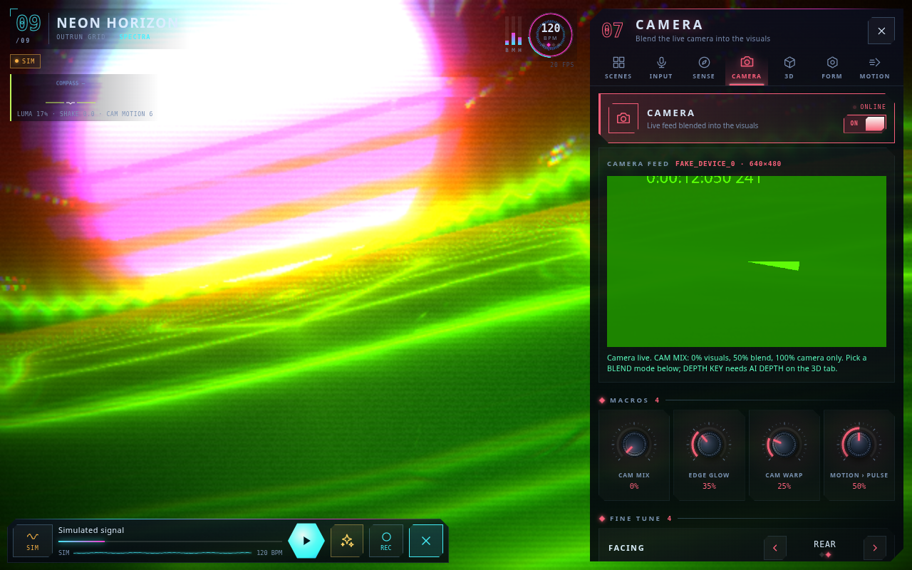
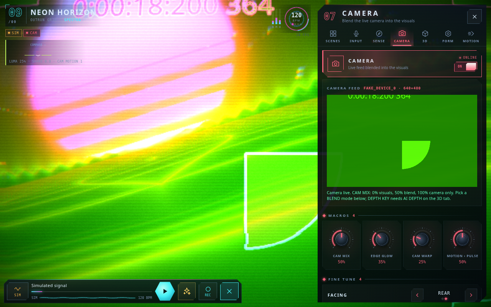
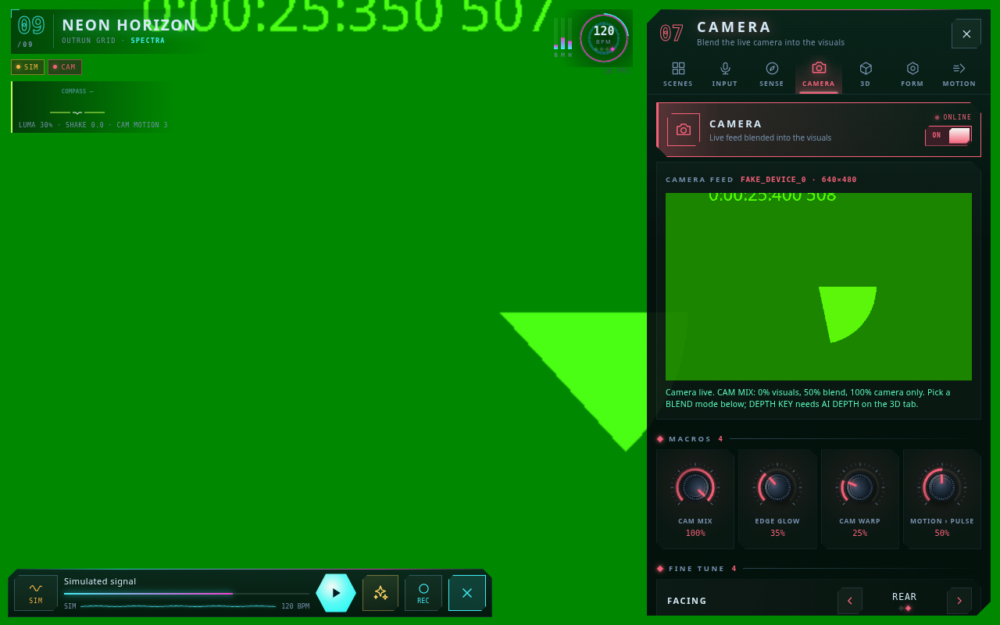

# Neuroflux: the complete user guide

**Make the visuals move. Mix the camera in. Capture a take worth keeping.**

A practical, plain-English manual for the current Neuroflux Visual Rig. Covers the live rig, all 110 core controls, camera mixing, sensors, 3D, AI tools, recording, audio routing, editing, exports and sharing.

**Edition:** 23 October 2026. Includes independent Camera FX, Silence Stop, portable whole-app setups, guided walkthroughs and the offline-cache update recovery page. The default values in this guide mean a clean first-run setup; your saved settings or a loaded preset can be different.

**Open the app:** [neuroflux-rig.vercel.app](https://neuroflux-rig.vercel.app/). If a phone acts as though an update never happened, use [Load the latest version](https://neuroflux-rig.vercel.app/update.html), then tap **UPDATE AND OPEN NEUROFLUX**. It refreshes app files while keeping saved recordings and settings. Finish active recordings and exports first.

## 1. What this app is doing

Neuroflux is a visual instrument. Pick a source of sound, choose a visual world, then shape how that world reacts. You can play it gently like a moving backdrop or push it like a live VJ performance.

Think in four layers:

1. **The source:** a loaded track, the built-in demo, a live mic/interface, desktop tab audio where supported, or the silent simulated signal.
2. **The visual:** one of nine engines, shaped with FORM and MOTION, colored with COLOR, and styled with FX.
3. **The performers:** audio reactivity, camera, your fingers, phone sensors, hand tracking and the director can all push the look.
4. **The take:** the recorder builds a separate output picture and audio mix, then saves it on your device.

That fourth layer matters. What you see while operating the app and what you put in a saved video do not have to be identical. You can keep a menu open while tweaking and still record a clean picture.

The current app records, exports and hands files to your device's share sheet. It does **not** broadcast your visuals to RTMP/stream URLs or publish directly to social accounts. Platform presets are framing shortcuts. The word STREAM in the lyrics tool means live speech transcription, not a YouTube/Twitch broadcast.

## 2. Your first good-looking minute

1. Open Neuroflux in a normal browser tab. If the app asks how to start, choose **DEMO** for real built-in sound or **SILENT** to start with motion paused; press Play when you want silent simulated motion. You can also choose **FILE** or **MIC / BT**.
2. Open the bottom-right **Menu** button. On a phone the controls rise in a sheet; on a wide screen they sit to the side. The tab strip scrolls sideways, so swipe it to find more pages.
3. Open **SCENES** and load a factory scene such as **OUTRUN**, **LIQUID SUN** or **DMT GATE**. This gives you a coordinated starting look.
4. Open **FX**. Keep FEEDBACK roughly 60–80% and BLOOM around 30–60% while you get a feel for the image. These are starting suggestions, not hard rules.
5. Open **REACT**. Leave INPUT GAIN near 1–1.2× and try BASS › ZOOM around 20%. Listen to a few kicks before making the next change.
6. Move just one control at a time. If the image gets lost, lower FEEDBACK, BLOOM and EXPOSURE before changing ten other things.
7. To keep this look, go to **SCENES → MEMORY BANKS** and hold **A**, **B**, **C** or **D** for about half a second. Holding an occupied slot replaces its saved look.

For a first recording, choose **RECORD → OUTPUT**, start with one 720p/30 output and **Clean**, then tap **REC**. Preparation and the output test happen first; a visible **3–2–1** happens just before the take begins. Tap the red stop control to save. Open **RECORD → LIBRARY** to play and download the take.

**Important:** the keyboard shortcut **R means Randomize**, not Record. The REC button is your recording control.

## 3. Find your way around the screen

### The bottom dock

| Item | What it is for |
|---|---|
| Source button / SIM, DEMO, FILE, MIC or SYS chip | Opens the source chooser. **INPUT DEVICES** takes you to device selection. **SILENT** returns to simulated analysis without actual sound. |
| Track/status strip | Shows the current source or track and a progress/scrub strip where there is room. Scrub a loaded file to seek; the demo scrub strip jumps through its generated arrangement. It is not a playlist editor. |
| Large Play/Pause button | Controls the current source. For a live mic/system source, pausing releases that input. In silent SIM mode, Play/Pause explicitly runs or pauses the silent simulation. It starts paused. It does not pause a recording. |
| Sparkle / AI button | Tap for the text prompt panel; hold to speak a short visual instruction. |
| REC | Starts a take using saved recording settings. During preparation it can cancel; during recording it becomes a red Stop/Save control with elapsed time. |
| Recorder Pause/Resume | Appears next to REC while a take is running. It pauses the take, not the music or camera. |
| Menu grid / close icon | Opens or closes the native control sheet. |

On a very narrow phone, track information can shrink or disappear while recording so Stop, Pause and Menu still fit. The controls have not been removed from your recording options.

### The top and the little badges

The scene name/number tells you which engine is active; tap it to go to SCENES. The colored **B / M / H** meters show analyzed bass, mid and high energy. The BPM reactor shows the app's estimate of the pulse; tap it for REACT. Badges such as MIC, CAM, HANDS or DIR show active features and take you to the relevant page when tapped.

BPM is estimated, not a metronome setting. Silent simulation uses a synthetic 120 BPM signal; the demo's arrangement is 124 BPM. Detection can settle on a related half/double-time pulse with real music.

### The menu map

| Page | Use it when you want to… |
|---|---|
| QUICK | Pick an engine, reach performance commands, and use your pinned controls. |
| RECORD | Set up the take, output framing, recording audio and local library. |
| AI | Type/speak a look, run the director, track hands, or show lyrics. |
| SCENES | Pick engines, load factory scenes, save/recall four look slots. |
| INPUT | Choose what the rig hears and which live input device to use. |
| SENSE | Use touch, tilt, gyro, shake, heading or available light information. |
| CAMERA | Choose a camera and blend it with the visual. |
| 3D | Enable camera depth or load a scan file. |
| FORM | Shape the active visual engine. |
| MOTION | Set time, travel, spin, origin and automatic drifting. |
| COLOR | Choose a palette and grade the picture. |
| FX | Add trails, glow, lens distortion and texture. |
| REACT | Decide how sound and detected beats move the picture. |
| SYSTEM | Adjust operator quality/UI, telemetry, wake behavior and app updates. |

### Dragging, resetting and pinning

- **Knobs:** drag up or right to increase; down or left to decrease. Think “slide the value,” not “trace a perfect circle.” A diagonal drag combines the two directions.
- **Faders:** drag to change the level. Their value is still just a control amount; a fader is not automatically an audio volume control.
- **Double-tap a knob/fader:** returns that control to its built-in default. This can differ from the value in the preset you just loaded.
- **Choice rows:** use their left/right arrows, tap the value area to cycle, or drag sideways. Examples are BLEND, PALETTE and SYMMETRY. Do not assume every choice row uses the knob double-tap behavior.
- **Switch rows:** tap to toggle. Keyboard Enter/Space also works when the switch has focus.
- **Hold ordinary knobs/choice/switch rows:** pins or unpins that control in QUICK, roughly a half-second hold. Primary power cards use their own switch behavior rather than every one supporting pinning.
- **ORIGIN XY pad:** drag within the pad to set both axes. Double-tap to center it.
- **Scrolling:** scroll the menu body between groups; swipe the tab strip sideways for hidden tabs. On a phone, the sheet handle lets you change its open position. On a wide screen the sheet uses a side layout.

### Gestures on the art itself

Touch the exposed canvas to use TOUCH FX. With TOUCH FX on, a **two-finger swipe left** goes to the next engine and a right swipe goes to the previous one. With TOUCH FX off, a quick horizontal single-finger swipe can do that job instead. Double-tap the canvas to hide/show the operator interface. These gestures belong on the art, not on a dial or menu row.

**HIDE UI** removes the operator controls; it is separate from recorded Menu visibility. Use the small reveal control, double-tap the canvas, or press H to bring the interface back. Fullscreen is offered only where the browser supports the requested fullscreen API.

## 4. How to mix without turning it into soup

A good mix usually has a clear main idea. Choose one: a tunnel you travel through, a person with graphics around them, a crisp symmetrical pattern, or a soft moving color field. Then let the other controls support that idea.

A reliable order is **engine → form → motion → color → trails/glow → audio response → camera/other performers → recording preview**. You can work in a different order, but changing everything at once makes it hard to know what helped.

Start from a readable image. Turn off AUTOPILOT, AI DIRECTOR and BEAT JUMP while learning a look. If hands or sensors are on, they can add movement too. Bring FEEDBACK and BLOOM down, keep EXPOSURE near 1×, and get FORM where you like it. Then add one effect at a time.

**Feedback is the picture remembering itself.** With a lot of memory, small zoom/spin/color changes repeat and build up. That is why a tiny TRAIL SPIN can produce an enormous spiral. If the image has become a bright smear, drop FEEDBACK to 0 briefly, then raise it more gently.

**Base amounts and modulation add up.** A low base CHROMA does not guarantee no color separation if HIGH › CHROMA or the director is adding more. A steady TIME dial does not guarantee steady pace if LEVEL › TIME or hand/sensor effects are active. When something “moves by itself,” check the performers before assuming the dial is broken.

For transitions, try a slow CAM MIX move from 25% to 50% to 85%, or ease FEEDBACK down while changing engine, then bring the trails back. Use extreme GLITCH, INVERT or fast SPIN as a deliberate moment rather than the only thing the picture ever does.

## 5. QUICK, SCENES and keeping a favorite look

### Engine versus factory scene

An **engine** is the kind of visual math. A **factory scene** is an engine plus a styled selection of geometry, motion, color and effects. Engine selection generally leaves your current styling in place. A factory scene resets the relevant visual controls to a baseline and applies its stored values, with many continuous controls easing over roughly a second. It does not reconfigure your audio hardware, camera or recording settings.

| Engine | The feel | Good controls to explore first |
|---|---|---|
| HYPERTUNNEL | A polar tunnel/wormhole with a central rush. | THRUST, SYMMETRY, TWIST, TRAIL ZOOM. |
| KALI VORTEX | Folding fractal structures and dense, jewel-like detail. | DETAIL, MORPH, WARP, FEEDBACK. |
| GYROID CATHEDRAL | A volumetric/raymarched architectural world. | DETAIL, ZOOM, TWIST, THRUST; watch device load. |
| LIQUID PLASMA | Flowing color and melted, cloud-like shapes. | WARP, MORPH, PALETTE, gentle motion. |
| JULIA BLOOM | Fractal islands/blooms with escape-time detail. | DETAIL, MORPH, ZOOM, modest trail spin. |
| CELL DIVISION | Cells with bright edges and organic subdivision. | DENSITY, MORPH, PALETTE, MID › WARP. |
| HYPERSPACE | Star streaks and a sense of forward speed. | THRUST, DENSITY, BLOOM, FEEDBACK. |
| SONIC MANDALA | Layered spectral rings and radial patterns. | SYMMETRY, DETAIL, DENSITY, audio gain. |
| NEON HORIZON | Retro horizon, sun and outrun grid. | SYMMETRY OFF, THRUST, SCANLINES, PALETTE. |

The nine factory buttons are **DMT GATE, KALI VORTEX, CATHEDRAL, LIQUID SUN, JULIA BLOOM, CELL DIVISION, HYPERSPACE, MANDALA and OUTRUN**. Keyboard 1–9 loads those factory scenes in that order; it is not simply a bare engine-number shortcut.

| Control | Range / initial default | What it does, and how to mix it |
|---|---|---|
| **SCENE ENGINE** | 9 engines; default HYPERTUNNEL | Chooses one of the nine procedural shader engines—the basic kind of world you are looking at. **Try this:** Changing the engine keeps many of your current styling controls. Loading a factory scene also loads a particular setup, so the two actions can look quite different. |

### QUICK commands and pins

**RANDOMIZE / RND** rolls a new engine and selected visual styling values within built-in ranges. It leaves source/device/camera/recording setup alone. **AUTOPILOT** gradually drifts selected parameters over time. **NEXT SCENE** advances the engine. **FREEZE** holds procedural time, **HIDE UI** clears the operator interface, and **FULLSCREEN** asks the browser to expand the app.

Pin a few things you will actually play: CAM MIX, FEEDBACK, BLOOM, TIME and a color control make a useful starting group. Long-hold again to unpin. Pins are shortcuts to the same controls, not independent copies.

### The four memory banks: A–D

1. Get a look you like.
2. Hold a slot for about half a second to store it. A filled slot is indicated visually. A short tap on an empty slot also stores the current look.
3. Tap a filled slot to recall it; holding a filled slot overwrites it.

Banks store the supported visual look controls: scene engine, form, much of motion, color and FX. They do **not** store a complete production session, a track file, input devices, camera setup, AI settings, recording framing, stems or exported media. FREEZE/REVERSE can be stored; automatic drifting is outside the stored look. Disable unwanted automation separately.

**INIT** returns the supported visual/look controls to their built-in initial values. It is not “erase my recordings,” a full app factory reset, or a reset of all device permissions. There is no general undo stack for randomizing, initializing or overwriting a bank, so store a safe look before exploring.

Banks and pins are local to that browser/site. There is no in-app bank-export/import or cloud sync in this version. A saved recording is a finished picture, not a preset you can load back into the dials.

## 6. INPUT: choose what the app hears

The main rig has **one active analysis source at a time**. Switching from a file/demo to MIC or SYSTEM changes what drives the visual; it is not a two-deck DJ crossfader. You can add a separate microphone for recording alongside music from RECORD → AUDIO, but that extra input is a different layer.

| Source | What you get | What to know |
|---|---|---|
| SILENT / SIM | A made-up rhythmic signal so the visuals still move, without a real music track. | Good for experimenting quietly. It can look audio-reactive even though no microphone is being heard. |
| DEMO | The built-in generative “Phase Lock” arrangement, 124 BPM. | Actual sound; convenient for testing a whole recording flow. Scrubbing jumps through the arrangement. |
| FILE | A locally selected audio file, such as MP3, WAV or M4A if the browser can decode it. | The file plays in the app and loops. Use the dock strip to seek. Pick the file again after a fresh session; there is no persistent track library/playlist importer. |
| MIC / BT | A browser-exposed microphone input: built-in mic, headset, USB interface or another OS-provided device. | Pair/connect the hardware in the operating system first. Allow the browser permission, then choose the input under INPUT DEVICE. |
| SYSTEM | Captured tab/desktop audio through the browser's sharing picker, where supported. | Primarily a desktop option. It is hidden on touch-oriented/mobile layouts and when the browser lacks the required API. Choose an audio-sharing option in the picker; sharing a screen without audio provides no usable audio source. |

### Get a live mic or interface working

Open **INPUT → MIC / BT**, allow access, and check **INPUT DEVICE**. Tap **SCAN** if the list is out of date. Tap the device you actually want; names may remain vague until permission has been granted. Watch the input meter and status readout, not just the existence of a device name.

Bluetooth labels are helpful hints rather than a direct Bluetooth pairing system. A headset in call mode may have thin high frequencies and extra delay. For a tighter music response, a wired interface/USB route is often easier to control. Your phone still decides which interfaces and input routes Chrome can see.

For direct music feeds, start with ECHO CANCEL, NOISE SUPPRESS and AUTO LEVEL off. For speech near speakers, try the processing options one at a time. These are browser/device requests, so their exact behavior can vary.

| Control | Range / initial default | What it does, and how to mix it |
|---|---|---|
| **INPUT TRIM** | 0–4×; default 1.00× | Boosts or reduces the live microphone/system input before analysis and the recorder's input tap. This is software gain, so it cannot fix distortion already coming from a clipped hardware input. **Try this:** Start at 1×. Raise it for a weak input; lower it if the level meter is constantly slammed. It affects the captured live-source signal as well as visual response. |
| **NOISE GATE** | 0–50%; default 4% | Ignores low-level energy when the rig analyzes live microphone/system audio. It quiets unwanted visual twitching from room noise; it is not a general-purpose noise-removal effect on your saved audio. **Try this:** Start around 2–6%. Raise it until the room stops triggering the picture, then stop. Too much makes quiet passages look unresponsive. |
| **ECHO CANCEL** | OFF / ON; default OFF | Asks the microphone/browser to cancel speaker sound getting back into the mic. **Try this:** Useful for talking near speakers. For a direct music feed, start OFF so processing does not flatten the music; changing it reconnects the main mic input. |
| **NOISE SUPPRESS** | OFF / ON; default OFF | Asks the microphone/browser to suppress steady background noise. **Try this:** Try it for voice in a noisy room. Leave it OFF for a clean interface or music feed unless it solves a real problem. Device support varies; changing it reconnects the main mic. |
| **AUTO LEVEL** | OFF / ON; default OFF | Asks the microphone/browser to automatically ride the input level. **Try this:** Handy for uneven speech. It can soften the difference between quiet sections and big drops, so try OFF for deliberate music dynamics. Changing it reconnects the main mic. |

### Three different gain jobs

- **INPUT TRIM:** changes the live input signal. It can affect both captured live audio and the analysis.
- **REACT → INPUT GAIN:** changes how strongly the analysis drives the visuals. Use this to make a weak-looking response stronger without turning the recorded mix up.
- **RECORD → AUDIO recording gains:** change what goes into the saved mix, independently of visual response. Use these to balance music against voice.

Do not try to solve a visual sensitivity problem by making the saved audio painfully loud. Likewise, lowering recording gain cannot repair audio that is already clipped at the microphone/interface.

The main live microphone is not automatically sent to speakers for monitoring. For intentional monitoring, use the recording audio controls and headphones. Speaker sound can feed back into a mic and can also make the visual react twice to the same musical event.

## 7. FORM: sculpt the world

These dials describe the engine, so their visual meaning changes a little from world to world. DENSITY in a tunnel is not the exact same thing as DENSITY in cells. Find the range that reads well in the current engine rather than chasing a supposedly perfect number.

| Control | Range / initial default | What it does, and how to mix it |
|---|---|---|
| **DETAIL** | 0–100%; default 55% | Sets geometric/iteration detail in the active visual engine. **Try this:** More detail can look richer and cost more GPU time, especially in fractal/raymarch scenes. Around 30–60% is a sensible phone starting range. |
| **ZOOM** | 0.3–3×; default 1.00× | Changes the scale or zoom of the active engine's geometry. **Try this:** Try 0.8×, 1× and 1.3×. Because engines construct their worlds differently, a larger number does not look like the exact same camera move in every scene. This is different from recorded-output Zoom. |
| **SYMMETRY** | OFF through 16-FOLD; default 6-FOLD | Sets kaleidoscope-style symmetry: OFF or 2–16 folds. **Try this:** OFF is useful for recognizable camera/scan compositions and the horizon scene. 4–8 folds is a nice middle ground; 12–16 can become dense and mandala-like. Individual engines interpret symmetry differently. |
| **WARP** | 0 to 2; default 0.60 | Distorts the underlying procedural space or pattern. **Try this:** Raise it gradually to make the world bend and melt. If the image stops reading clearly, ease WARP back before piling on other effects. |
| **DENSITY** | 0–100%; default 50% | Changes how tightly packed or frequent the engine's repeated shapes are. **Try this:** Use it to make the picture busier or more spacious. It affects pattern content rather than recording pixel resolution or the 3D point count. |
| **MORPH** | 0–100%; default 40% | Moves the engine through variations of its internal shape. **Try this:** Think of it as a character dial: a small move can uncover a very different look. It does not automatically crossfade between different shader engines. |
| **TWIST** | -2 to 2; default 0.30 | Adds directional twist/spiral structure; 0 is neutral and negative/positive values twist differently. **Try this:** Try −0.3 and +0.3 with moderate symmetry. Small moves can change a tunnel or fractal a lot; it is a shape control rather than the continuous SPIN speed. |
| **SPECTRUM RING** | OFF / ON; default OFF | Draws a live frequency-spectrum ring over the procedural image. **Try this:** Useful when you want the audio response to be obvious. Turn it off for a cleaner camera-led composition; it follows the main visual/camera crossfade. |

## 8. MOTION: set the pace and point of view

TIME advances the engine's clock; THRUST is the amount of travel through its world; SPIN rotates it; ORIGIN places the center. Those jobs overlap visually, but they are different controls. If a scene feels dizzy, lower SPIN and WOBBLE first and keep THRUST moderate.

| Control | Range / initial default | What it does, and how to mix it |
|---|---|---|
| **TIME** | 0–3×; default 1.00× | Sets the procedural animation clock speed. **Try this:** 1× is the normal pace; 0 stops that clock, but audio modulation and some live/post effects can still move. For a slow backdrop, try 0.3–0.6× before freezing everything. |
| **ORIGIN** | −1 to +1; default center | Moves the visual's horizontal origin using the shared ORIGIN XY pad. **Try this:** Drag left/right to place the center. This is creative composition inside the rig; output framing has its own left/right control. Double-tap the XY pad to return both axes to center. |
| **ORIGIN Y** | −1 to +1; default center | Moves the visual's vertical origin on the same ORIGIN XY pad. **Try this:** Drag up/down to place the center. ORIGIN Y is the second axis, not a separate screen that you need to find. Keep it near center when a symmetrical scene should stay balanced. |
| **SPIN** | -1 to 1; default 0.10 | Sets continuous visual rotation speed; negative and positive values turn in opposite directions. **Try this:** 0 stops this rotation. Around ±0.05–0.2 is usually easier to watch than a full-speed spin. Physical gyro and hand gestures can add their own movement. |
| **THRUST** | 0–3×; default 1.00× | Controls how fast you move through the active engine's world. **Try this:** Most obvious in tunnels and HYPERSPACE. It works with TIME and may have a subtler interpretation in flat scenes. Raise it for forward rush without using a huge continuous spin. |
| **WOBBLE** | 0–100%; default 20% | Adds a gentle moving wobble to the procedural view. **Try this:** A little keeps a static look alive. Lower it for geometric precision or if the composition feels seasick. |
| **FREEZE** | OFF / ON; default OFF | Stops the rig's procedural time progression while leaving audio-driven movement possible. **Try this:** Use it for a held moment on a beat. It is not a still-image capture, does not pause the camera, and is not the recorder's Pause button. |
| **REVERSE** | OFF / ON; default OFF | Runs the procedural clock backward. **Try this:** It can reverse time-based travel/animation without reversing your music, camera video or recorded file. Combine with a modest TIME value for a readable transition. |
| **AUTOPILOT** | OFF / ON; default OFF | Lets the rig periodically drift selected creative parameters on its own. **Try this:** Good for an unattended background. Turn it off if you want a dial to stay where you put it; it is separate from the song-aware AI DIRECTOR. |
| **DRIFT RATE** | 0–100%; default 45% | Controls how frequently AUTOPILOT chooses new drifting targets. **Try this:** Low is more leisurely, high changes direction more often. It has no effect when AUTOPILOT is off and is not the same as AI CHANGE RATE. |

**Freeze is not record-pause.** FREEZE can leave camera motion, audio-reactive geometry, feedback/post effects and live gestures active. Recorder Pause actually leaves that time out of the take. Music Play/Pause is a third, separate action.

## 9. COLOR: choose the mood, then protect the detail

Start with PALETTE and HUE. Then set EXPOSURE and CONTRAST so shapes remain readable. Add SATURATION last. If you are mixing a face into the image, judge skin and background together—bright neon, strong contrast and colored trails can take over quickly.

| Control | Range / initial default | What it does, and how to mix it |
|---|---|---|
| **PALETTE** | 6 palettes; default SPECTRA | Chooses SPECTRA, ACID, SOLAR, GLACIER, CANDY, or TOXIN. **Try this:** Find a palette you like before fine-tuning HUE. The same palette can look very different at different exposure, saturation and blend settings. |
| **HUE** | 0–360°; default 0° | Offsets the procedural palette's color position. **Try this:** Use it to find a color family that suits your track or branding. It interacts with HUE DRIFT and any compass/hand modulation, so turn those down if you want a fixed hue. |
| **HUE DRIFT** | 0–100%; default 15% | Continuously drifts the palette hue. **Try this:** 0% keeps the automatic hue clock still; a little drift is good for long ambient passages. It does not stop an AI or sensor from changing the overall look. |
| **EXPOSURE** | 0–2×; default 1.05× | Scales the final picture's brightness/exposure. **Try this:** Start near 1×. If the image looks like a white blob, lower this and BLOOM first. This control grades the visual synthesizer track. Use Camera FX → Exposure for the camera itself. |
| **SATURATION** | 0–200%; default 115% | Sets how much color survives in the final visual grade. **Try this:** 0% is grayscale, 100% is normal color amount, and higher values push it harder. More is not always richer—very high values can flatten color detail. |
| **CONTRAST** | 0.5–2×; default 1.10× | Separates dark and bright parts of the image. **Try this:** Around 1× is a useful neutral point. Higher contrast can make the picture punchier but crush detail; lower contrast is softer. |
| **TRAIL HUE** | -0.1 to 0.1; default +0.006 | Shifts the color of feedback history as it repeats; negative and positive values move the shift in opposite directions. **Try this:** It needs visible FEEDBACK to matter. Tiny values go a long way because the change repeats frame after frame. |
| **POSTERIZE** | 0–100%; default 0% | Reduces smooth shading to fewer visible color bands. **Try this:** Keep 0% for smooth gradients. Raise it for a graphic, print-like or retro look; strong settings can make faces look harsh in a blend. |
| **INVERT** | OFF / ON; default OFF | Turns the final image into a negative-style image. **Try this:** Use it as a momentary change of mood. BEAT INVERT is a separate rhythmic toggle; combining them changes which part of the cycle looks negative. |

## 10. FX: trails, glow, lens and texture

FEEDBACK, TRAIL ZOOM, TRAIL SPIN, TRAIL WARP and TRAIL HUE work on history. BLOOM, CHROMA, GLITCH, LENS and texture controls change the current final look. If a trail-related control seems to do nothing, make sure enough FEEDBACK exists to reveal it.

| Control | Range / initial default | What it does, and how to mix it |
|---|---|---|
| **FEEDBACK** | 0–99%; default 84% | How much of the previous picture remains in the next one—the main trail length control. **Try this:** Around 50–75% is easier to keep readable; 85–95% gives longer, more immersive history. Near the top it can smear or accumulate brightness. Drop it to 0 to let old trails clear. |
| **TRAIL ZOOM** | -0.05 to 0.05; default +0.012 | Makes feedback history expand inward/outward relative to the center. **Try this:** Positive values produce a zooming-in/expanding-history feel; negative values pull history the other way. Try about ±0.005–0.015. 0 stops this particular trail motion. |
| **TRAIL SPIN** | -0.05 to 0.05; default +0.004 | Rotates the previous image a little on every feedback pass. **Try this:** Tiny positive/negative values make spirals in opposite directions. Pair it with FEEDBACK around 70–85%; large values can turn the whole view into a spinning smear. |
| **TRAIL WARP** | 0–100%; default 20% | Warps the old trail image before mixing it back in. **Try this:** This makes history look liquid without being the same dial as FORM WARP. Keep it low when you want clean geometric echoes. |
| **CHROMA** | 0–100%; default 30% | Separates red, green and blue sampling slightly for color fringes. **Try this:** Around 10–25% can add energy. Reduce it for readable faces, small text or clean edges. HIGH › CHROMA can add more on top of your base setting. |
| **BLOOM** | 0–150%; default 75% | Adds a glowing halo around bright parts. **Try this:** A little glow goes a long way when FEEDBACK is high. Values can go above 100%, so check that you are not turning every highlight into a white patch. |
| **GLITCH** | 0–100%; default 8% | Adds digital blocks, horizontal shifts and broken-image accents. **Try this:** Keep it near zero for a clean visual, and bring it up briefly for transitions. The DIRECTOR's drop effects can add extra glitch even if this base dial is low. |
| **LENS** | -1 to 1; default 0.15 | Bends the final image with a lens-like warp; negative and positive values bend differently. **Try this:** 0 is neutral. Try a little for a curved tunnel or wide-lens feeling; stronger settings can distort a camera/visual blend. |
| **MIRROR** | OFF, X, XY, QUAD, 5–16-SPLIT; default OFF | Chooses OFF, X, XY, QUAD, or any radial split count from 5 through 16 for the final visual. **Try this:** X folds horizontally; XY folds both directions; QUAD adds a more complex fold. The 5–16-SPLIT choices repeat and reflect the picture around the center, like a kaleidoscope. This is an artistic effect, separate from normal front-camera mirroring. |
| **SWIRL** | −1 to +1; default 0 | Twists the whole picture around the center, strongest near the middle. Negative and positive turn the twist in opposite directions. **Try this:** Start at ±0.15–0.3 with a 6-SPLIT or 8-SPLIT mirror. 0 is neutral. This Visual FX control reshapes the synthesizer only. Use CAMERA → CAMERA FX → Swirl for camera-only treatment. |
| **RIPPLE** | 0–100%; default 0% | Adds moving circular waves to the entire picture, like ripples spreading through a lens. **Try this:** Start at 10–25% with modest feedback. Silence Stop holds its animation when the selected input becomes quiet. It is separate from SENSE → TOUCH MODE → RIPPLE. |
| **WAVE** | 0–100%; default 0% | Makes the picture undulate horizontally and vertically with animated sine waves. **Try this:** Start at 10–20% for a watery bend, then try a radial mirror. Combine gently with SWIRL; high values of every warp at once can hide the original subject. |
| **PIXELATE** | 0–100%; default 0% | Turns the picture into larger pixel blocks. **Try this:** Low settings give a retro texture; high settings hide detail fast. It is a look, not a smaller export file or a recording-resolution setting. |
| **SCANLINES** | 0–100%; default 22% | Adds horizontal display/CRT-style scanlines. **Try this:** Try 10–30% for a light screen texture. It does not change actual frame rate or interlace the video. |
| **GRAIN** | 0–100%; default 18% | Adds a moving noise texture. **Try this:** A little makes a clean digital scene feel less clinical. High grain can look messy and make compressed uploads harder to keep clean. |
| **VIGNETTE** | 0–150%; default 80% | Darkens the edges so the center feels more prominent. **Try this:** Start low when important content sits near the corners. High values make a strong tunnel/spotlight feel and can hide edge details. |

**Try a new kaleidoscope mix:** Choose MIRROR → 6-SPLIT or 8-SPLIT, set SWIRL around 0.2, RIPPLE around 15%, and keep WAVE at 0 until the first two feel right. Then introduce WAVE slowly. Every radial split from 5 through 16 is available; higher counts produce finer repeated wedges. These controls now belong to the independent visual synthesizer track. To repeat or warp only the camera, use CAMERA → CAMERA FX. The dedicated camera kaleidoscope has every division from 1 through 16.

**A clean reset for an overloaded look:** lower FEEDBACK to 0 for a moment, set GLITCH and POSTERIZE to 0, set EXPOSURE near 1×, reduce BLOOM, and switch off rhythmic inversion/strobe. Bring only the useful bits back. 100% CAM MIX keeps Camera FX. To see the untreated camera, bypass Camera FX; this does not reset the visual synthesizer.

## 11. REACT: make it dance with the right part of the music

The visual analyzer groups sound into bass, mids and highs. You choose which visual behavior each group pushes. Start with a good input level, then set a response you can feel at a comfortable scale. A short test with a clear beat is easier to tune than a noisy room full of competing sounds.

| Control | Range / initial default | What it does, and how to mix it |
|---|---|---|
| **INPUT GAIN** | 0–3×; default 1.20× | Amplifies the signal used to drive visuals, not the recording's output mix. **Try this:** Start at 1–1.2×, then raise only if the meters and response are weak. High values can pin the analysis and make everything react all the time; they do not repair a poor audio source. |
| **BASS › ZOOM** | 0–100%; default 35% | Makes bass energy add zoom/scale movement. **Try this:** Start around 15–35% for a pulse you can read. If every kick makes the whole scene lurch, lower this before reducing the music recording level. |
| **MID › WARP** | 0–100%; default 40% | Lets midrange energy add procedural warp. **Try this:** It can respond nicely to vocals, guitars and synths. Lower it when dense music makes the visual busy even between kick drums. |
| **HIGH › CHROMA** | 0–100%; default 50% | Makes high-frequency energy add color separation/chroma. **Try this:** Good for hi-hats and bright percussion. Reduce it if outlines constantly split apart; increase modestly if a thin Bluetooth/call-mode input has weak high-frequency response. |
| **LEVEL › TIME** | 0–100%; default 40% | Makes overall signal level speed up procedural time. **Try this:** Low values keep the pace more predictable. High values can make loud sections rush forward even when the base TIME dial stays still. |
| **BEAT THRESHOLD** | 1.05–2×; default 1.35× | How strong a bass peak must be relative to recent bass energy to count as a beat. **Try this:** Lower means easier/more frequent triggers; higher means pickier/fewer triggers. It is not a BPM selector. Adjust after your input level is sensible. |
| **SMOOTHING** | 0–95%; default 60% | How gently analyzed audio values settle instead of dropping abruptly. **Try this:** Higher gives a smoother, more floaty release; lower feels snappier. If the visual never seems to let go of the last hit, bring this down a bit. |
| **BEAT PUNCH** | OFF / ON; default ON | Adds a short zoom punch on detected beats. **Try this:** A good first rhythmic effect. If a delicate camera blend is bouncing too much, switch it off before changing the camera framing. |
| **BEAT STROBE** | OFF / ON; default OFF | Adds a white flash on detected beats. **Try this:** Use deliberately: it produces repeated flashes. Leave it off for viewers sensitive to flashing, and check DROP FX too if you want a flash-free performance. |
| **BEAT INVERT** | OFF / ON; default OFF | Toggles negative/normal-style inversion as beats arrive. **Try this:** This is a strong rhythmic effect and can also create intense light changes. For a stable grade, leave it off and use the regular COLOR INVERT switch only when wanted. |
| **BEAT JUMP** | OFF / ON; default OFF | Chooses a different shader engine every 16 detected beats. **Try this:** Useful for hands-free variety, but those beats depend on detection. It is not a precisely authored arrangement or a guaranteed musical-bar counter. |

### Tune a beat response in four moves

1. Use a source you can actually hear or meter. SIM will produce a fake pulse, so it cannot prove your microphone is working.
2. Set INPUT GAIN near 1–1.2×. Get B / M / H moving without being permanently pinned high.
3. Bring BASS › ZOOM up slowly. Add MID › WARP and HIGH › CHROMA only if you want those parts of the song to contribute.
4. Set BEAT THRESHOLD for sensible hits, then adjust SMOOTHING for a crisp or floaty release. Check several quiet and loud passages.

A house groove and a drumless ambient track will not detect the same way. The BPM readout and BEAT JUMP use detected events; they are not a sample-accurate synchronization system or external MIDI clock. There is no manual BPM-entry dial in this version.

## 12. CAMERA: mix the real world into the visual

Open **CAMERA**, switch the camera on, allow permission, then confirm that the small CAMERA FEED preview is live. Pick FRONT for a selfie or REAR for the room/subject. If the preview is not live, the CAM MIX dial has no camera picture to bring in.

### The 0–50–100 crossfade

| CAM MIX position | What you should see in the actual picture |
|---|---|
| 0% | The procedural visual. The little camera preview inside the operator menu can still be live. |
| 1–49% | The selected artistic blend gradually comes in. |
| 50% | The full selected blend of camera and visual. This is not necessarily a mathematical 50/50 opacity blend: SCREEN, ADD and the key modes combine images differently. |
| 51–99% | The complete visual/effect composition fades away toward the camera. |
| 100% | Processed camera-only picture with its dedicated Camera FX and usual crop/front-camera mirroring. Visual-synth effects and history fade out. Bypass Camera FX for the untreated feed. |

The camera-only endpoint does not hide your operating menus on the screen. For an uncluttered **saved** picture, choose **RECORD → OUTPUT → Menu visibility → Clean** and switch off any optional recorded title, branding, lyrics or skeletons you do not want. Those separately selected output overlays can still be drawn over a camera-only base.

<figure class="camera-examples">

<figcaption>0%: the main picture is visuals.</figcaption>

<figcaption>50%: the selected SCREEN blend.</figcaption>

<figcaption>100%: camera-only base picture.</figcaption>

</figure>

*These are screenshots of the app using Chrome's synthetic test-camera feed. The green pattern is the test source, not a camera fault or a special Neuroflux effect. Operator controls remain visible; the output profile determines recorded overlays.*

### Choose a blend at 50%, then choose your final balance

| BLEND | In ordinary language | A useful starting situation |
|---|---|---|
| SCREEN | A bright, light-over-light combination. Dark parts of the camera contribute less. | Neon patterns over a darker room or a person against a dark background. |
| ADD | Adds camera and visual brightness aggressively. | Short, energetic peaks; lower EXPOSURE/BLOOM if highlights blow out. |
| DIFF | Shows differences between the two pictures, often making unusual contrast/colors. | Abstract performance and silhouettes; less suitable when natural skin color matters. |
| MULTIPLY | Multiplies the two pictures with the app's brightness scaling; darker areas can dominate. | Using camera shapes as texture in the graphic. It is not a precise photographic opacity blend. |
| LUMA KEY | Lets camera brightness decide where the camera replaces the visual. | A bright subject/light against darker surroundings; adjust KEY LEVEL. |
| DEPTH KEY | Uses estimated depth, when available, to decide where to show the camera. | A subject separated in depth from the background. Enable AI DEPTH in 3D for actual depth-based input; without it the shader uses a brightness fallback. |

These are blend/key treatments, not a chroma-key green-screen editor or a guaranteed person-cutout tool. Depth edges can shimmer and a brightness key can also pick out bright objects in the background.

| Control | Range / initial default | What it does, and how to mix it |
|---|---|---|
| **CAMERA** | OFF / ON; default OFF | Makes the live camera available as a visible layer in the main picture. **Try this:** Switch it on and allow access. If hands/depth still need the camera, hiding the camera layer may leave the hardware active for those features. |
| **FACING** | FRONT, REAR; default REAR | Chooses FRONT or REAR camera, subject to the cameras the browser actually exposes. **Try this:** REAR is the default. FRONT is useful for selfies and hand conducting and is mirrored in the visual mix. Switching can briefly reopen the camera. |
| **CAM MIX** | 0–100%; default 70% | The main camera/visual crossfader: 0% is visuals, 50% is the full selected blend, and 100% is camera only. Above 50%, the complete visual/effect picture fades toward the camera. **Try this:** Use 25–40% to introduce the camera, 50% for the strongest selected blend, and 70–90% to bring the person or room forward. At 100%, Camera FX stay visible while visual-synth trails and grading fade away; operator menus can still be visible on your screen. |
| **BLEND** | SCREEN, ADD, DIFF, MULTIPLY, LUMA KEY, DEPTH KEY; default SCREEN | Selects SCREEN, ADD, DIFF, MULTIPLY, LUMA KEY, or DEPTH KEY. It changes the mixed look, not the 0%/100% endpoints. **Try this:** SCREEN is a friendly first choice. Compare the modes at 50% CAM MIX so you are actually seeing the full blend character. |
| **KEY LEVEL** | 0–100%; default 50% | Moves the threshold for LUMA KEY or DEPTH KEY. **Try this:** In LUMA KEY, higher values generally restrict replacement to brighter camera areas. In DEPTH KEY, adjust while watching the preview; it is a depth threshold, not an exact distance in meters. |
| **EDGE GLOW** | 0–100%; default 35% | Finds edges in the camera and adds colored glow to them. **Try this:** Around 10–25% can outline a person without overwhelming the image. It scales in with the first half of CAM MIX and disappears again at the camera-only endpoint. |
| **CAM WARP** | 0–100%; default 0% | A shortcut to the camera-only Local lens effect. Raising it adds/enables that effect in the camera stack; zero bypasses it. It uses one stack slot and stays visible at 100% CAM MIX. |
| **MOTION › PULSE** | 0–100%; default 50% | Uses changes between camera frames to trigger visual pulse/beat energy. **Try this:** Move a hand or walk across the shot to test it. Camera shake can also trigger it; lower the amount for handheld filming if the picture punches constantly. |
| **CAM TRAILS** | OFF / ON; default OFF | Adds/enables Camera trails in the camera-only stack. Turning it off bypasses that node. It uses one stack slot; the visual synthesizer keeps its own separate feedback history. |

### A practical face-and-visual mix

Use SCREEN, start at 30% CAM MIX, keep EDGE GLOW around 10–20%, and keep CAM WARP low. Move to 50% to see the full artistic blend. If the face is lost in the effects, move toward 75–90% instead of only pushing exposure. Move all the way to 100% for a clean camera reveal; crossfade back to bring the visual world in again.

**If 100% still looks like the old blended endpoint:** finish active work, open the [update recovery page](https://neuroflux-rig.vercel.app/update.html), and tap UPDATE AND OPEN NEUROFLUX on that phone/browser. A regular refresh can leave an old offline version active. Browser profiles and different phones keep their own caches.

## 13. SENSE: perform with your phone and fingers

Start in a comfortable position, enable MOTION SENSORS, answer any permission prompt, and tap **RE-ZERO**. Re-zero takes the current orientation as your reference; use it again after you change how you hold the phone. It does not calibrate the microphone or repair missing hardware support.

The SENSOR ARRAY/status area distinguishes readings the browser exposes from estimated/unavailable ones. Tilt and gyro need motion/orientation access. Heading needs usable compass/orientation data. Light can be camera-estimated when a real light sensor is not available. A desktop cannot respond like a handheld phone just because the switch is on.

| Control | Range / initial default | What it does, and how to mix it |
|---|---|---|
| **MOTION SENSORS** | OFF / ON; default OFF | Turns on the motion/orientation sensor listeners and requests permission where required. **Try this:** Hold your phone in the position you plan to perform from, enable it, then use RE-ZERO. A desktop or a browser that does not expose a sensor may show unavailable readings. |
| **TILT › ORIGIN** | 0–100%; default 50% | Moves the center of the visual as you tilt the device. **Try this:** Around 15–35% gives a gentle handheld feel. Higher values are more like steering the scene around the screen. |
| **TILT › FLOW** | 0–100%; default 50% | Uses tilt to push the trail/feedback flow. **Try this:** It is easiest to see with FEEDBACK turned up. Keep it low for a stable image; turn it up for drifting, liquid trails. |
| **GYRO › SPIN** | 0–100%; default 40% | Uses rotational motion from the device to add spin. **Try this:** Small wrist turns can add a lot of life. Lower it if the image keeps turning when you want a steady composition. |
| **SHAKE › PUNCH** | 0–100%; default 60% | Turns a physical shake into a visual punch or burst of energy. **Try this:** Use a small, deliberate gesture first. It depends on motion data, so a browser without accelerometer access cannot supply this trigger. |
| **TOUCH FX** | OFF / ON; default ON | Lets fingers or a mouse bend the visual canvas where you touch it. **Try this:** Leave ON for performance effects. With it ON, use two fingers to swipe between scenes; a single finger is your effect controller. |
| **TOUCH MODE** | RIPPLE, VORTEX, LENS, SHOCK; default RIPPLE | Chooses RIPPLE, VORTEX, LENS, or SHOCK for the touch field. **Try this:** RIPPLE sends out rings; VORTEX swirls; LENS bends/magnifies; SHOCK gives a more abrupt energetic disturbance. Try each with TOUCH FORCE around 40%. |
| **TOUCH FORCE** | 0–100%; default 70% | Sets the strength of canvas touches and touch-style hand pinches. **Try this:** Reduce it for subtle accents or small screens. Higher values are good for a few obvious performance gestures rather than constant dragging. |
| **COMPASS › HUE** | 0–100%; default 50% | Adds a color offset from the device's heading/compass information. **Try this:** Turn slowly to feel the palette respond. If there is no usable heading data, this control cannot invent one. |
| **LIGHT › GLOW** | 0–100%; default 50% | Lets ambient light influence glow. The app can use a light sensor when exposed, or estimate scene brightness from the active camera. **Try this:** Darker surroundings can produce more glow. Set this to 0% if you want BLOOM to stay consistent while lighting changes. |

For your first sensor mix, try TILT › ORIGIN 20%, TILT › FLOW 15% and GYRO › SPIN 10–20%, leaving a readable base scene. Hold the phone still and re-zero if the view drifts. For a locked-off recording, turn motion sensors off and leave touch gestures for intentional accents.

## 14. 3D: depth clouds and imported scans

There are two separate jobs on this page: **AI DEPTH** estimates a point cloud from the live camera; **LOAD SPLAT** opens an existing scan file. Neither is a full in-app room-scanning/capture workflow.

### Live camera depth

Switch on AI DEPTH and wait for the first download/initialization to finish. The app tries supported GPU acceleration and can fall back to a local CPU/WASM path. The model runs on the device; first-time model/runtime downloads need internet. A depth model can be a substantial download, so use the status message rather than guessing that a short delay means failure.

Begin with DEPTH RES FAST and CLOUD DENSITY LOW or MEDIUM. Bring CLOUD GAIN and POINT SIZE up until the cloud is readable. Then try a little ORBIT and BASS › BURST. A brightly lit, distinct subject is easier to read than a dim, blank wall. The estimated depth is relative and imperfect, not survey-grade distance data.

### Load a scan you already have

1. Export a supported **.ply**, **.splat** or **.spz** file from your scanning workflow.
2. Tap **LOAD SPLAT**, choose the file, and wait for the “loaded” status.
3. Start with SPLAT GAIN around 50–60% and SPLAT DENSITY low enough to run smoothly.
4. Toggle SPLAT FLIP if the orientation is wrong; reduce SPLAT SPIN to 0 while you inspect it.
5. Add ORBIT, spin or bass burst gradually. Use **CLEAR** to unload the imported scan from the current rig.

A file extension alone is not a promise: unsupported PLY layouts/SPZ variants or damaged files can fail to parse. The renderer centers/scales imported point data and can reduce a very dense source to fit its working point budget (up to roughly 600,000 imported points before density reduction). This is a lightweight point/splat performance view, not a full-quality Gaussian-splat editing or reconstruction application. Clearing does not delete the original file on your device.

| Control | Range / initial default | What it does, and how to mix it |
|---|---|---|
| **AI DEPTH** | OFF / ON; default OFF | Uses a downloaded AI model to estimate depth from the camera and make a live colored point cloud. **Try this:** Give it time to load the first time. This is estimated single-camera depth, not a LiDAR measurement or an automatic saved 3D scan. It can turn the camera on if necessary. |
| **DEPTH RES** | FAST, BALANCED, FINE; default FAST | Chooses FAST, BALANCED, or FINE for the depth-estimation input. **Try this:** Start FAST on a phone. Move up only if the cloud stays responsive and the device is comfortable. FINE means more work for the model, not guaranteed perfect edges. |
| **CLOUD DENSITY** | LOW, MEDIUM, HIGH; default MEDIUM | Chooses LOW, MEDIUM, or HIGH point density for the live depth cloud. **Try this:** This is separate from DEPTH RES: one controls the model input, the other how many points draw the result. Lower density first if the cloud is sluggish. |
| **CLOUD GAIN** | 0–150%; default 50% | Sets how strongly the live depth cloud is drawn. **Try this:** Use a little cloud over the visual for texture, or raise it to make the cloud the main attraction. 0% hides the cloud without being the same thing as turning the whole depth engine off. |
| **POINT SIZE** | 0.3–3×; default 1.00× | Changes the size of live-cloud points. **Try this:** Small points look more delicate; larger points fill gaps and look chunkier. The effect is easiest to judge together with CLOUD DENSITY. |
| **BASS › BURST** | 0–100%; default 50% | Lets bass and spectral energy spread the 3D points outward. **Try this:** Keep low to preserve a person's shape or an imported object. Raise it for the exploding-on-the-beat effect; it applies to the 3D rendering rather than changing your original scan file. |
| **ORBIT** | 0–100%; default 60% | Sets how much the 3D view orbits, including tilt-based and gentle automatic movement. **Try this:** Use a little for depth and parallax. Reduce it when the object keeps drifting away from a composition you like; motion sensors provide the physical tilt part when available. |
| **SPLAT GAIN** | 0–150%; default 60% | Controls the visible strength of an imported splat/point scan. **Try this:** Start near 40–60%. If nothing changes, check that a file is loaded; this dial does not create a scan by itself. |
| **SPLAT DENSITY** | 5–100%; default 60% | Chooses what fraction of the loaded scan points are drawn. **Try this:** Lower it for speed or a more airy point-cloud look. Higher values make the scan fuller and cost more GPU time. It does not increase the detail in the source file. |
| **SPLAT SPIN** | -1 to 1; default 0.15 | Sets continuous spin for the imported scan; negative and positive values turn in opposite directions. **Try this:** 0 stops the automatic spin. Try a small magnitude such as 0.05–0.15 before using a full turntable effect. |
| **SPLAT FLIP** | OFF / ON; default ON | Flips the imported scan's Y/Z orientation to help correct an upside-down load. **Try this:** Toggle it if a scan looks inverted. The loader already chooses a starting value by format; there is no universal flip setting for every scanning app. |

## 15. AI: prompts, director, hands and lyrics

This tab contains several independent features. Local audio analysis/director behavior and local camera models are different from requests sent to Gemini. You can make a great recording without using any online AI.

### Get a fresh, guided walkthrough

Open **Menu → AI → GUIDED WALKTHROUGH**. **WALKTHROUGH MODE starts OFF.** Turn its switch ON only when you want help; the app remembers that choice. Even with it enabled, a new session waits for you to begin or resume a walkthrough. Tell it what you want to do in ordinary language: “Help me record a clean portrait camera mix with music and a separate voice track,” or “Show me how to make a six-split kaleidoscope with a gentle swirl.” You can also choose **GUIDE ME STEP BY STEP** in the typed AI command window.

The guide looks up relevant parts of this manual and checks your current settings and browser capabilities. It makes a new plan for that setup. Read the plan first, then press **BEGIN WALKTHROUGH**. Building the plan does not change a setting or start a take.

The current step sits inside the app's native menu. On phones, the menu expands so the instructions and controls have room. A green outline points to the real control. Use **SHOW CONTROL** to find it again. Turn the dial yourself or tap **APPLY THIS SETTING**. **VERIFIED · NEXT** means the app has checked that setting. It does not mean the result sounds or looks good—that part is yours. Listening and visual checks say **I CHECKED THIS · NEXT**, because the guide cannot judge them for you.

Use **UNDO CHANGE** for a reversible setting, **SKIP** when a step is unnecessary, the minus button to minimize, or × to turn walkthrough mode OFF. You can also switch it OFF in the AI panel. Turning it off dismisses the highlighting and instructions, cancels a pending guide request and clears the resumable plan. Your visual/audio settings and any recording already in progress stay as you left them. **Change the plan / I'm stuck** lets you describe a problem and rebuild the remaining steps using the latest settings. If you reload the same tab, an explicit **RESUME WALKTHROUGH** lets you continue.

Starting a recording still needs your own tap on **START TAKE · 3–2–1**, followed by the normal countdown. Camera and microphone permissions still come from the browser. Read the step before granting access. The guide does not silently record, delete takes, upload files or publish anything. Its instructions and highlighting stay out of your recorded picture.

Each step has **Manual sources** so you can read the explanation. The plan names the model that answered. It tries **Gemini 3.8 Flash first**; if that is unavailable, a working Flash fallback is clearly labeled. This does not mean 3.8 handled a request that actually used another model.

Online guidance sends your written goal, numeric controls, supported recording/audio settings and browser capability flags to the app's Gemini service. It does not send source files, filenames, camera frames, recorded audio, lyric text, titles, branding text or API keys. Ordinary controls and recordings keep working if online guidance is unavailable. If the guide reports an older catalog, finish your take and use **SYSTEM → APP UPDATES → LOAD LATEST VERSION**.

### Type or speak a visual idea

Tap the dock's sparkle button or **TYPE A VIBE**, write a clear request, and submit it. Start with concrete creative changes:

- “Slow blue tunnel, soft glow, almost no glitch.”
- “Keep the current scene, lower the feedback and make the bass response gentle.”
- “A warm liquid plasma look with no strobe.”
- “Switch to the horizon scene, reduce spin and make the colors colder.”

The service translates the request into supported visual parameters/commands. It is not generating a new filmed video or writing an arbitrary shader from scratch. Check the result with your own eyes; broad instructions can be interpreted in several ways.

Hold the dock AI button to speak, or use **HOLD TO TALK**. Release after a short instruction. The voice capture is short (up to about nine seconds), and very short/silent clips may be rejected. The app may duck music monitoring while you speak. If the browser cannot open the mic, use typing instead.

**CHECK** refreshes the Gemini connection status. If the app reports no server key or an unavailable service, ordinary visuals/recording still work. The owner connects Gemini on the server; a guest should not paste an API key into a public prompt or share it in a recording. Usage/availability depends on the connected provider and its limits.

### AI DIRECTOR versus AUTOPILOT

AUTOPILOT drifts selected parameters. The DIRECTOR follows changes in the analyzed song energy and classifies broad sections such as **INTRO, GROOVE, BUILD, DROP, DRIVE and BREAK**. The song map and energy history show what it thinks is happening. It is a live estimate, not an imported cue sheet or a guaranteed prediction of an upcoming drop.

With GEMINI LOOKS off or unavailable, a local plan still supplies groove/build/drop/break looks. With Gemini connected and that switch on, the service can design the plan. DRIVE sets how hard modulation pushes; CHANGE RATE influences how often it looks for groove/drive changes. Manual edits get a short grace period before automatic look changes resume, but modulation can still be audible/visible in the result. Turn the director off if a value must stay fixed.

**LIKE** stores feedback about a look you enjoy. **SKIP** marks the current look as unwanted and chooses another. That taste is stored in this browser, not a universal model retrained for every user. **REPLAN** asks for/rebuilds the section plan. Local planning remains available when an online look request cannot complete.

### Conduct with your hands

Enable HAND TRACKING, let the model load, and make sure your hands appear in the preview. It opens the front camera if it needs to open its own camera, but an already-active rear camera can remain in use—choose **CAMERA → FACING → FRONT** deliberately for self-conducting.

| Gesture | Effect |
|---|---|
| Raise/lower your hands | Adds or reduces energy-related speed/brightness/glow modulation. |
| Move left/right | Shifts color/hue. |
| Open/close your hands | Changes warp strength. |
| Use two hands, move apart/together | Changes zoom/scale. |
| Tilt the line between two hands | Adds visual twist/rotation. |
| Pinch thumb and index finger | Acts like a touch effect at the tracked fingertip when PINCH FX is enabled. |
| Fist, then open quickly | Triggers a burst/punch, which can include a flash. |
| Fast open-hand swipe | Can change to the next/previous scene. |

Use good lighting, keep hands in frame, and begin with HAND FORCE around 30–50%. SHOW SKELETON affects the operator overlay; the saved video's Hand skeletons option is separate. Hiding the visible camera layer does not necessarily release a camera still needed by hands/depth. Turning tracking off is how to stop tracking.

### Live lyrics

Enable LIVE LYRICS with real music/vocals or a live input. **PREVIEW** inserts sample words so you can try typography without treating that as successful transcription. LANGUAGE guides recognition; it does not translate a song into another language. IMPACT, FLOW and KARAOKE change the live presentation.

STREAM uses an online live-transcription connection; CLIP sends short audio chunks and is normally a few seconds behind. A failed stream can fall back to CLIP. Noise, overlapping voices and music can cause missing/misheard words. The current output recorder renders selected recognized text as a simpler overlay; it does not copy the exact on-screen kinetic typography or promise subtitle-file export.

Recording silence does not automatically stop online lyric analysis. If you do not want lyric audio transmitted, turn LIVE LYRICS off, rather than only muting the recorded mix.

| Control | Range / initial default | What it does, and how to mix it |
|---|---|---|
| **AI DIRECTOR** | OFF / ON; default OFF | Listens to the main analysis and performs looks according to detected song energy/sections. **Try this:** Give it a few seconds to listen. It can use a local plan without a Gemini key; online Gemini-designed looks are an optional additional layer. |
| **DRIVE** | 0–100%; default 65% | Sets the DIRECTOR's modulation strength: how hard builds, drops and energy changes push the visual. **Try this:** Try 25–45% when you still want to steer manually. Higher feels more dramatic. It is a creative intensity control, not the audio recording volume. |
| **CHANGE RATE** | 0–100%; default 50% | Sets how frequently the DIRECTOR looks for beat-aligned changes in groove/drive sections. **Try this:** Lower gives longer-held looks; higher checks more often. Changes remain conditional, so a higher value does not guarantee a new scene at a fixed interval. |
| **GEMINI LOOKS** | OFF / ON; default ON | Lets the connected Gemini service design a plan of looks for song sections. **Try this:** If Gemini is unavailable, the local director can still make a plan. Turn this off to keep planning local; text prompts/voice/lyrics have their own online requirements. |
| **DROP FX** | OFF / ON; default ON | Allows the DIRECTOR's drop flashes, shocks and glitch hits. **Try this:** Turn off for a gentler set or when you want to avoid drop flashes. Also disable BEAT STROBE/BEAT INVERT and avoid burst gestures if flashes are unwanted. |
| **HAND TRACKING** | OFF / ON; default OFF | Tracks up to two hands with the active camera, loading the hand model on first use. **Try this:** FRONT camera is easier for conducting. It can use a camera already running on REAR; set FACING deliberately. Tracking is processed locally after model loading. |
| **HAND FORCE** | 0–100%; default 70% | How strongly tracked hand movement pushes the scene. **Try this:** Around 30–50% is easier to learn than full strength. Lower it if small hand movements keep overpowering the look. |
| **SHOW SKELETON** | OFF / ON; default ON | Draws tracked hand skeletons on the operator display. **Try this:** Turning the drawing off does not turn tracking off. Recorded hand skeletons have a separate option under RECORD → OUTPUT. |
| **PINCH FX** | OFF / ON; default ON | Makes a thumb/index-finger pinch act like a touch at the fingertip. **Try this:** Choose a TOUCH MODE in SENSE for its character. Keep the hand in frame with clear lighting; pinch recognition is less reliable with occlusion or fast motion. |
| **LIVE LYRICS** | OFF / ON; default OFF | Listens for vocals and turns recognized words into animated on-screen text. **Try this:** Needs a working Gemini connection and an audible/input signal. Recognition is approximate and can lag or mishear lyrics; preview a take before treating the words as final captions. |
| **TYPE STYLE** | IMPACT, FLOW, KARAOKE; default IMPACT | Chooses IMPACT, FLOW, or KARAOKE for live words. **Try this:** IMPACT emphasizes individual words; FLOW builds lines; KARAOKE highlights words in a line-style presentation. Recorded lyrics use a simpler text rendering rather than an exact copy of these DOM animations. |
| **TYPE SIZE** | 0.5–1.6×; default 1.00× | Scales the live operator-display lyrics. **Try this:** Around 1× is the reference size. This does not promise the same size/style in the recording overlay; use the output preview to judge recorded text. |
| **LANGUAGE** | AUTO, ENGLISH, SPANISH, PORTUGUESE, FRENCH; default AUTO | Chooses AUTO, ENGLISH, SPANISH, PORTUGUESE, or FRENCH for transcription guidance. **Try this:** Pick the language you expect if AUTO struggles. It guides recognition; it is not a translation-language selector. |
| **ENGINE** | STREAM, CLIP; default STREAM | Chooses STREAM or CLIP transcription. **Try this:** STREAM means live transcription, not broadcasting your visual to a platform. CLIP listens in roughly four-second chunks with a few seconds of lag; STREAM can fall back to CLIP if live connection fails. |

## 16. RECORD: start, pause and save a take

Open **Menu → RECORD**. Its four subtabs are **RECORD, OUTPUT, AUDIO and LIBRARY**. The dock REC shortcut uses your last settings; the menu is where you make intentional changes before the next take.

### The whole recording flow

1. Set the source, visual, camera and effects you want to perform with.
2. In OUTPUT, choose A's shape/resolution/fps, recorded overlays and audio source. If needed, configure B too and enable dual recording in RECORD.
3. In AUDIO, set music/mic recording balance, select/enable an extra mic if needed, and check the meters.
4. In RECORD, choose video or audio-only, optional companion files and an optional duration limit.
5. Use **TEST OUTPUT** for a video configuration. The app renders the selected output(s) for about two seconds and asks for at least 80% of the selected frame rate. A failing test does not secretly drop your resolution; lower the load and test again.
6. Tap **REC** in the dock or **● RECORD · 3–2–1** in the page. Preparation can take a moment. Every new take then shows 3, 2, 1 for about a second each. Nothing is captured during those three seconds.
7. During that countdown, **CANCEL**, Escape, or the dock preparation control cancels the take and removes its empty prepared files.
8. When capture begins, the recording menu closes. Change the visuals as usual. The dock shows elapsed time, a red Stop/Save control, and Pause/Resume.
9. Tap red Stop/Save and let saving finish. Open LIBRARY, play the result, and download important work.

The countdown is fixed for each new take; there is no “None” option. Resume continues the same take rather than starting a fresh countdown. Time spent paused is left out of the saved take. Audio playback and live camera activity can continue while the take is paused.

### Every control on the RECORD subtab

| Control | What to do with it |
|---|---|
| RECORD · 3–2–1 | Starts with the current setup after preparation/test and the countdown. |
| TEST OUTPUT | Checks the current video composition load. Test with the real camera/effects enabled; a lighter test does not prove a heavier performance will work. |
| SNAPSHOT | Saves/downloads a PNG of the selected output's current composed picture. Safe guides and recording controls are excluded. It is also listed in Library. |
| PAUSE / RESUME | Temporarily leave time and changes out of the take, then continue. Not the source Play/Pause. |
| STOP & SAVE | Finalizes the current take's files. Wait for the saved message. |
| MARKER | Adds a timestamp marker to the current take. Later it can be tapped to seek in Library. It does not add a visible title to the picture or split the file automatically. |
| Capture | Video recording, or Audio only · WAV. Audio-only captures the mixed WAV and skips the video-rendering performance test. |
| Stop after seconds · 0 = manual | Optional automatic duration cap, up to 14,400 seconds (four hours). It is a maximum setting, not a guarantee that a phone/storage/codec can sustain it. 0 means you stop manually. |
| Record output B at the same time | Records a second independent visual composition. B's preview alone does not enable recording B. This is a second shape/mix of the same live rig, not a second camera or a separate song. |
| Save separate music and microphone WAV files | Saves isolated companion sources before the recorder's gain/mute controls. You may get a silent companion if no corresponding source was active. |
| Also save the mixed audio as a WAV file | Adds a standalone mix WAV alongside video. Audio-only already creates a mix WAV. |
| Storage estimate | Approximate free space available to this browser/site, not necessarily the phone's entire disk. |
| PLAY DEMO | Starts the built-in demo through the normal main source routing. It changes the main source; use it intentionally. |
| PROTECT DEVICE STORAGE | Requests persistent browser storage where supported. A grant can reduce automatic eviction; it is not a backup or a promise against manual site-data clearing. |

A video normally includes its chosen audio track; companion WAVs are additional files. A/B videos and music/mic/mix companions appear as separate Library items. Removing one companion does not automatically remove the others.

## 17. OUTPUT: decide what the saved picture looks like

OUTPUT A and OUTPUT B each have their own profile. Choose the tab before adjusting values. **A is recorded by default**; **B is preview only until dual recording is enabled**. Both use the same live scene/camera performance but render to their own composition sizes and feedback histories.

### Shape, resolution and motion

| Setting | What it means |
|---|---|
| Platform preset | Sets a starting width/height and approximate preview safe area. It does not connect an account, upload a file or guarantee a platform's current acceptance limits. |
| Width / Height | Custom pixel dimensions. Each must be even and between 128 and 3840; total area cannot exceed 3840 × 2160 pixels. Device limits also apply. |
| Resolution shortcut | 720p for a lighter take, 1080p for more detail, 2160p for permitted desktop configurations. |
| Frame rate | 24, 30 or 60 fps. 60 needs a capable configuration and a successful test; it is not automatic motion smoothing. |
| Output orientation | Landscape, portrait or square composition with upright text at rotation 0°. |
| Rotate entire picture | 0°, 90° clockwise, 180° or 270° clockwise. Rotates the visual **and all recorded overlays/text**. A 90°/270° rotation swaps encoded width/height. |
| Framing | Render for this shape; Fit operator aspect; or Fill from operator aspect. See below. |
| Zoom | 1–2× framing zoom of this output. This is not FORM → ZOOM and does not change both outputs together. |
| Frame left/right; up/down | −1 to +1 positioning of excess image area. If the image already exactly fills that axis, panning there can have little/no visible effect. |
| Fit background | Color behind a letterboxed/pillarboxed fit. It does not replace the scene palette. |

### Orientation versus rotation—the part that causes confusion

**Want a normal landscape video with readable upright words?** Choose Landscape and leave Rotate entire picture at 0°.

**Want a normal vertical phone video?** Choose Portrait and rotation 0°.

**Want the entire saved picture sideways, including letters?** Use 90° or 270°. For example, a 1920 × 1080 base picture at 90° becomes an encoded 1080 × 1920 sideways composition. If you want sideways content *inside a landscape-shaped encoded file*, start from a portrait base and rotate 90°; check the final pixel readout.

Physically turning the phone and rotating the recorded composition are separate actions. Keep the device orientation settled during the take: dimensions/fps/orientation/rotation/framing configuration is locked until you stop. For the standard landscape/portrait choice, use Output orientation first and the preview/readout as the final check.

### The three framing modes

- **Render for this shape · no stretching:** asks the visual engine to make a fresh composition for the output's aspect. This is usually the best choice when recording both portrait and landscape.
- **Fit operator aspect · background:** preserves the operator-aspect picture and fits it completely inside the chosen output, adding background space where necessary.
- **Fill from operator aspect · crop:** fills the chosen frame from an operator-aspect rendering, cutting off edges as necessary.

Neither Fit nor Fill is an exact screenshot of the browser interface. They are visual renders with different aspect handling. If framing cuts off your subject, lower output Zoom, use Fit, or move the frame. Cropping after recording cannot bring back content that was never captured.

### Platform presets in this version

| Preset | Starting pixels | Shape |
|---|---|---|
| YouTube · landscape | 1920 × 1080 | 16:9 |
| TikTok · vertical | 1080 × 1920 | 9:16 |
| Instagram Reels | 1080 × 1920 | 9:16 |
| YouTube Shorts | 1080 × 1920 | 9:16 |
| Instagram Stories | 1080 × 1920 | 9:16 |
| Instagram · square | 1080 × 1080 | 1:1 |
| Instagram · portrait feed | 1080 × 1350 | 4:5 |
| Custom | Starts at 1920 × 1080; editable | Your valid dimensions |

The dashed safe area is an approximate **preview-only** guide. It is not burned into the video and is not an exact map of a social app's current buttons, captions or cropping. Check the destination app's actual upload preview.

### Clean, minimal or full recorded menus

| Menu visibility | Saved result |
|---|---|
| Clean · visuals only | No performance HUD/menu. Separately enabled lyrics, skeletons, title and branding can still draw, so turn those off too for a completely bare picture. |
| Minimal performance HUD | A compact performance strip with whichever Scene name, BPM, Palette and Audio meter items you enabled. |
| Full performance menu | A drawn performance-control panel/navigation using the shared state of the relevant rig page. It is not a screen recording of every button or browser menu. |

Full performance output is a re-created overlay. It can show the active performance controls and a navigation overview, but it is not a pixel-for-pixel copy of the scrollable operating menu. The recording page itself is excluded; the renderer uses the last performance page when you are adjusting recorder settings. Dialogs, source chooser popups, permission prompts and recording controls are not captured as browser screenshots.

### Every overlay/audio option

| Option | What to know |
|---|---|
| Scene name | Shows the active scene/engine name in minimal/full HUD. |
| BPM | Shows the estimated BPM in minimal/full HUD. |
| Palette | Shows the selected palette in minimal/full HUD. |
| Audio meter | Shows analyzed bass/mid/high energy in minimal/full HUD, not a guarantee of recorded audio volume. |
| Lyrics | Adds currently recognized lyric text even in Clean mode. It is simpler than the live animated typography. |
| Hand skeletons | Adds tracked skeleton lines even in Clean mode; tracking must be supplying hands. |
| Recorded title | Optional text, up to 80 characters, drawn near the top of the picture. |
| Your branding | Optional text, up to 60 characters, drawn near the lower part of the picture. It is text, not a logo-image uploader. |
| Audio for this output | Music + microphone mix, Music/system only, Microphone only, or Silent video. Choose independently for A and B. |
| Show safe-area guide in preview only | Toggle composition guidance without recording it. |

Some creative framing/overlay settings can be adjusted live; geometry/format and per-output audio-track choices are fixed while a take runs. Confirm everything in the actual output preview before starting. If you burn a menu, lyric or title into a video, it cannot be switched off afterward like an editable layer.

## 18. AUDIO: balance the saved music and voice

This is the recorder's mix, separate from REACT. “Music” means the main file/demo/program source or the selected SYSTEM source. “Microphone” means the main live mic when MIC is the selected source, or a separately enabled recording microphone while a different source is playing.

### Record music and voice together

1. Choose FILE or DEMO as the main rig source.
2. In **RECORD → AUDIO**, tap **ENABLE AUDIO** if necessary.
3. Choose a Microphone device and tap **ENABLE MICROPHONE**. This extra mic can run alongside the track. Selecting it here does not automatically make it the rig's main analysis source.
4. Start with Music recording gain around 0.7–1× and Microphone recording gain near 1×. Speak at the real performance level; watch for clipping on the mix meter.
5. Use headphones. Keep Microphone headphone level at 0 until you actually need to hear yourself.
6. Set **Audio for this output** to Music + microphone mix, and enable separate WAV companions if you want to rebalance after the take.

The main source selector still chooses one analysis source. An extra recording mic does not automatically make your voice drive the same visual analyzer that is currently listening to the track.

### Every AUDIO control

| Control | Range / job |
|---|---|
| ENABLE AUDIO | Resumes/initializes the local audio graph. Browsers often need a user gesture before sound/capture can run. |
| PLAY DEMO | Starts the normal built-in demo source for checking levels. |
| Music recording gain | 0–2×. Scales recorded music/system audio. 1× is the starting point; 0 is silence for that source. |
| Mute music in outputs | Mutes the music contribution after its isolated-source tap. |
| ENABLE MICROPHONE | Opens the chosen extra mic, or uses the main mic where appropriate. Permission and hardware availability still apply. |
| RELEASE EXTRA MIC | Stops the separately owned recorder mic. It does not turn off a main mic still selected in INPUT. |
| Microphone device | Browser-exposed input selection for the extra recording mic. Choose first, then enable/re-enable to apply it. |
| Microphone recording gain | 0–2× for the captured mic contribution. |
| Mute microphone in outputs | Mutes the mic contribution after its isolated-source tap. |
| Mute mixed recording audio · visuals keep reacting | Mutes the combined mix bus. It does not mute isolated music/mic-only output buses or raw WAV companions; use their own mute settings or choose Silent video when that is your intent. |
| Audio sync | −500 to +500 ms. **Positive delays music; negative delays microphone.** This is source-to-source audio alignment, not a general camera/video timing fix. |
| Music headphone level | 0–1. Changes music/program monitoring, initially 0.9. It is separate from Music recording gain. Changing program monitoring can also affect analysis of that monitored program path; recheck visual response if you turn it far down. |
| Microphone headphone level | 0–1, initially 0. Use headphones before raising it to avoid speaker feedback. Hearing yourself late can be normal monitoring latency. |
| Music / mic / mix meters | Show peaks for the respective buses. Red means reduce gain/check the source. They help balance, but a meter alone does not prove that the chosen output is using that bus. |

### What “separate audio” really means

A normal video can contain the chosen audio. Optional **music WAV**, **mic WAV** and **mix WAV** are additional files. Music/mic companions are captured before recorder gain/mutes, which is why a muted final video can still have a useful isolated source to remix. Those companions are not untouched hardware recordings: device processing and the main INPUT TRIM may already have affected the input.

If the device has already mixed music and voice into one input stream, the app cannot pull them apart into genuinely isolated sources. A “music” or “mic” name describes the routing, not AI source separation. A camera microphone is not silently added just because the camera is visible; enable the audio input you want.

For a truly silent deliverable, choose **Silent video** for that output. If you also want no audio companion files, turn off the separate/mixed WAV options. Muting an output does not turn off a lyric service or stop the visual analyzer from listening.

## 19. LIBRARY: play, organize and protect your takes

Everything here is saved in this browser on this device/site. A take saved in Android Chrome will not automatically appear in iPhone Chrome, a private tab, another browser profile or a different site address. There is no account-based media backup in this version.

Open **RECORD → LIBRARY**, tap a take, and play it. A/B videos, stems, mix WAVs, PNG snapshots and newly finished exports appear as separate items. The file card shows type, duration, size and dimensions when relevant, plus an interrupted status if saving did not finish normally.

| Action | What it does |
|---|---|
| RENAME | Change the name field, then tap RENAME. Typing without committing the action is not the same as saving the name. |
| DOWNLOAD ORIGINAL | Downloads the stored original with its actual format/extension. It does not secretly convert WebM to MP4. |
| SHARE FILE | Hands the file to the device's supported share sheet; if file sharing is unavailable, downloads it for manual upload. |
| Marker buttons | Seek to marked moments in the Library player. They are take-relative navigation aids, not an automatic montage. |
| USE CURRENT FRAME AS THUMBNAIL | For a video, play or seek to a frame, then save it as the Library thumbnail. |
| DOWNLOAD COVER IMAGE | Downloads the stored thumbnail as a separate image. Social apps may require choosing their own cover during upload. |
| CREATE NEW EXPORT | Opens the finishing workflow for the chosen range/format/framing/audio options. Creates a new Library item. |
| CANCEL EXPORT | Stops the current conversion job; keeps the original. |
| DELETE FROM THIS DEVICE | Deletes this one item after confirmation. Download a copy first if you need it. There is no in-app trash/undo. |
| ← LIBRARY | Returns to the list. |

Browser storage is working storage, not an archive. Download important takes, and check that the downloaded file actually plays. Protect Device Storage is worth requesting, but it cannot prevent you or the browser/OS from clearing site data. The update recovery page deliberately preserves recordings/settings; the browser's general **Clear site data** command does not make that promise.

If a take is marked **INTERRUPTED**, download the original before trying to finish it. Saved chunks may be useful, incomplete, or unplayable depending on the interruption/container. The label is an honest status, not a guarantee of repair.

## 20. Finish, export and share

Recording saves the live take. Exporting makes a new trimmed/reframed/converted file from a saved item. The original stays unchanged, so you can make several versions—but each finished version uses more device storage.

### Trim and export a video

1. Open the take in LIBRARY and check playback.
2. Set **Start · seconds** and **End · seconds** under FINISH & EXPORT. Example: Start 12.0 and End 42.0 makes an approximately 30-second section. End must be after Start and inside the take.
3. Pick **MP4 · H.264 + AAC**, **MP4 · silent video**, or **WAV · audio only**. Audio items offer WAV; image snapshots do not go through this video/audio export form.
4. Keep recorded dimensions or choose a destination framing preset.
5. Choose **Fit · preserve complete picture** or **Fill · crop edges**.
6. Set **Audio level**, initially 1×, from 0–2×. Lower it if the mixed file is too loud.
7. If usable companion sources exist, optionally enable remixing and set their separate levels/offset.
8. Tap **CREATE NEW EXPORT** and keep the tab open until the new Library item appears. Download/share that new item, or cancel and keep the original.

### Remix companions after a take

When music/mic companion files from the same take are available, the export form offers **Remix available companion sources instead of recorded audio**. With it enabled, the source WAVs replace the existing recorded audio for that new export.

Use **Music level** and **Microphone level** from 0–2×. **Microphone offset · seconds** ranges from −0.5 to +0.5; here, **positive delays the mic, negative moves it earlier relative to music**. Notice the difference from the live AUDIO page's sync sign convention. Test a short section with an obvious clap or spoken consonant before committing a long export.

If there are no companion files, the form tells you so. You can change the existing mix's overall level, but you cannot recover an isolated voice/music part that was never saved. Deleting a needed companion removes its usefulness for later remixing. WAV can extract existing audio or make a remix; it does not generate a missing audio source from a silent video.

### Fit versus Fill after recording

**Fit** preserves the whole recorded picture with padding where necessary. **Fill** crops it to fill the target. Both operate on the finished saved frame, including anything burned into it. Reframing cannot invent what was outside the original camera/visual frame, and it cannot turn a burned-in menu or caption into an editable layer. Plan two output shapes at recording time when you need truly independent portrait/landscape compositions.

### MP4, WebM and WAV—why you may see more than one

The live recorder uses a supported native format: MP4 if a suitable recorder codec is available, otherwise WebM. A file named .webm really is WebM; renaming it to .mp4 is not conversion. WAV is uncompressed PCM audio and can be much larger than an AAC audio track of the same length.

The finish/export worker attempts supported local H.264/AAC conversion and can fall back to a bundled local software converter. It does not upload your take to a conversion service. Unsupported/large jobs can fail honestly while leaving the downloadable original intact.

| Export limit in this version | What it means in practice |
|---|---|
| Touch/mobile source memory budget: 64 MB | The source recording plus any companion sources used for remixing must fit that job's input budget. A very short trim of a huge source still has a huge source to open. |
| Desktop source memory budget: 256 MB | More headroom, not a promise that every browser has suitable codecs or unlimited RAM. |
| Software fallback: 64 MB of source files and a five-minute processing timeout | The conversion job must finish within that time. This is a processing-time limit, not a promise about how long a source clip can be. |
| Storage headroom check | You need room for the new output as well as the original. Trimming does not automatically delete source media. |

### How much space should you allow?

These are rough planning figures, not fixed output sizes. Actual codecs, content and the browser can change them. Uncompressed WAV companions can add up surprisingly quickly.

| Example | Approximate storage per minute |
|---|---|
| One 720p/30 video | About 25 MB of video, plus its audio track. |
| One 1080p/30 video | About 56 MB of video, plus its audio track. |
| One 1080p/60 video | About 112 MB of video, plus its audio track. |
| One stereo PCM16 WAV at 48 kHz | About 11.5 MB. The actual audio-context sample rate can differ. |
| Music + mic + mix WAVs together at 48 kHz | About 34.6 MB, on top of any video files. |

Companion WAVs use 16-bit PCM stereo at the active audio context's sample rate. Two video outputs also add their own video storage. A minute of 1080p video plus companions can easily exceed a phone's 64 MB local-export input budget when remixing, even if storage has room for the take. For mobile editing/sharing, try short 15–30-second takes first and verify one export before recording a long performance.

If finishing fails, download the original and finish on a device/editor that can handle it, or record shorter takes next time. Do not delete the only source file just to make a failed export form look empty.

### Hand it to Instagram, TikTok, YouTube or another app

Use **SHARE FILE** when your device offers the destination. Installed apps decide whether they accept that type/length/size. If sharing is absent or rejected, download the appropriate original/export, open the destination app's upload flow, and select the file there. Typical routes are Reels/Stories for Instagram, Create/Upload for TikTok, and Create → Upload video for YouTube; platform wording and requirements can change.

These presets and share actions do not schedule posts, add platform captions/hashtags, connect social accounts, or start a stream. Always check the destination preview for cropping, overlays, orientation, audio level and cover selection before you publish.

## 21. Practical mix recipes

The numbers below are suggested starting points, not built-in presets. Save your own result in a bank once it works. Before each recipe, turn off AUTOPILOT/AI DIRECTOR/BEAT JUMP unless the recipe calls for them; other modulation can change what the same dial numbers appear to do.

### A. Clean music visual, no camera

Load LIQUID SUN or OUTRUN. Turn CAMERA off, set FEEDBACK around 55–70%, BLOOM 30–50%, EXPOSURE near 1×, and keep GLITCH low. Use BASS › ZOOM around 15–25%, MID › WARP 10–25%, and HIGH › CHROMA 10–20%. Set output Clean with no optional text/skeletons if you want only the art. Record a short test with the real track.

### B. A person inside the neon

Turn CAMERA on, pick FRONT/REAR intentionally, choose SCREEN and set CAM MIX to 35% to begin. Set EDGE GLOW around 15%, CAM WARP around 5–10%, and CAM TRAILS off. Ease CAM MIX to 50% for the full blend, then toward 75–85% when the person needs to read more clearly. If the whole mix washes out, lower BLOOM/EXPOSURE rather than simply adding more saturation.

### C. Camera reveal for a transition

Build a look around 25–40% CAM MIX. At your chosen moment, move toward 100%. The visual layer and its effects fade out, leaving camera only. Hold that shot, then crossfade back to 50% or lower. Use a clean recorded output and disable optional overlays for a truly bare camera deliverable. Record and review a short pass to judge your pacing.

### D. Long, dreamy tunnels

Load DMT GATE or HYPERSPACE. Try TIME 0.4–0.7×, THRUST 0.5–1×, FEEDBACK 85–92%, TRAIL ZOOM around +0.005 to +0.015, and a small TRAIL SPIN around ±0.003 to ±0.008. Keep SPIN and WOBBLE low, and leave GLITCH/strobe off. Lower INPUT GAIN or reactivity if the music keeps breaking the calm. Long trails amplify small moves, so let a change settle before adding another.

### E. Crisp beat-driven geometry

Use SONIC MANDALA, CELL DIVISION or a low-feedback KALI VORTEX. Try FEEDBACK 35–60%, BLOOM 20–40%, BASS › ZOOM 25–35%, and BEAT PUNCH on. Use lower SMOOTHING for a snappier release. Keep BEAT STROBE off unless flashes are a deliberate part of the performance. Raise BEAT THRESHOLD if every small fluctuation counts as a kick.

### F. Your voice over a track

Choose FILE/DEMO as the main source. In RECORD → AUDIO, enable an extra mic, use headphones, keep mic monitoring initially at 0, and balance music/voice around normal speech. Choose mixed audio for Output A and enable separate WAVs. Make a ten-second take with a loud sentence and a quiet sentence; listen before doing the full performance. Use the companions to rebalance later rather than trying to fix an overloaded source.

### G. Silent visuals now, flexible audio later

Choose Silent video for the output. If you want audio available for later remixing, leave separate music/mic WAV capture on. If you want no saved audio files at all, turn companion/mix WAV options off too. The visual can still react to audio; “silent video” describes the file, not whether the analyzer or lyric service is running.

### H. One performance, portrait and landscape

Set A to 1920 × 1080 and B to 1080 × 1920, both rotation 0° and Render for this shape. Give each its own overlay/audio choices. Enable “Record output B at the same time,” then TEST OUTPUT with the actual effects/camera active. On a phone, start with 720p equivalents—1280 × 720 and 720 × 1280—and 24/30 fps. If the test fails, lower quality or record one shape. Dual output is extra rendering and encoding, not a free duplicate.

### I. Hand-conducted performance without visible camera

Enable HAND TRACKING, set FACING to FRONT, and check the tracker preview. Set HAND FORCE around 35%. Turn the visible CAMERA layer off if you want only procedural visuals while still tracking. Start with slow open/close and left/right gestures; add pinch after those feel predictable. Disable SHOW SKELETON on the operator display if desired, and separately leave recorded Hand skeletons off. Avoid fist-open bursts if you want no flashes.

### J. A live 3D silhouette

Enable AI DEPTH with good light. Start FAST depth, LOW/MEDIUM cloud density, CLOUD GAIN around 50%, POINT SIZE near 1× and BASS › BURST around 10–25%. Use modest ORBIT. If the cloud is hard to distinguish from the procedural background, simplify FORM/FX or reduce background brightness first. Lower model/point settings if the phone warms up; rendering more dots does not fix a poor depth estimate.

### K. Gentle hands-free set

Pick one automation approach first: low-rate AUTOPILOT for gradual drift, or AI DIRECTOR around DRIVE 25–40% with a slower CHANGE RATE for song-aware changes. Leave DROP FX, BEAT STROBE and BEAT INVERT off for a less aggressive set. Judge a full quiet-to-loud section before adding more automation. Save a manual recovery look in a bank so you have somewhere dependable to return.

## 22. SYSTEM, performance, offline use and privacy

| Control | Range / initial default | What it does, and how to mix it |
|---|---|---|
| **HUD OPACITY** | 30–100%; default 96% | Changes opacity of the on-screen operator HUD/interface. **Try this:** Lower it if the controls feel too heavy over the art. It does not set the opacity of menus burned into the recorded output. |
| **UI SOUND** | 0–100%; default 50% | Sets the app's interface click/chime volume. **Try this:** 0% makes the controls quiet. These sounds are excluded from direct internal recordings, but a physical microphone near speakers can still pick them up acoustically. |
| **RESOLUTION** | ECO, BALANCED, HIGH, MAX; default HIGH | Sets the operator-screen rendering level: ECO, BALANCED, HIGH, or MAX. **Try this:** Lower this when the phone gets hot or the live view stutters. It is separate from recording width/height/fps, so also test the actual output before a take. |
| **GLASS BLUR** | OFF / ON; default ON | Turns frosted panel blur on/off. **Try this:** OFF can ease interface rendering cost on a struggling phone. It changes the menu appearance, not the recorded video's creative blur effect. |
| **TELEMETRY** | OFF / ON; default OFF | Shows rendering/audio telemetry on the operator screen. **Try this:** Use it to see whether the rig is struggling and to check what is running. It is not a recording-quality guarantee or a cloud analytics dashboard. |
| **KEEP AWAKE** | OFF / ON; default ON | Requests that the browser keep the screen awake while the rig is playing. **Try this:** Support varies, and it is not permission to background the app. Recording also requests a screen wake lock where available; keep the tab visible and the phone unlocked. |

### APP UPDATES

Open **SYSTEM → APP UPDATES → LOAD LATEST VERSION** if the app appears unchanged after a release. This takes you to the recovery page. Tap **UPDATE AND OPEN NEUROFLUX** while online. It removes the app's offline-file cache/service-worker registration, then loads the latest app; it leaves local settings and recorded media stores alone. It blocks when another tab holds an active capture lock. Finish exports first too.

A normal refresh and a deployed release are different facts: a phone can keep running its older offline shell even after the server is updated. Each browser/device needs its own refresh/update. Do not use general site-data clearing as your first fix if you need recordings stored there.

### A quality setting that actually runs is the good setting

SYSTEM RESOLUTION affects the operator screen. RECORD OUTPUT width/height/fps affects the saved composition. Lowering just the operator setting does not automatically lower recording quality or make a heavy dual-output take pass its test.

For a comfortable phone starting point, choose ECO or BALANCED operator resolution, one 720p output at 24/30 fps, and moderate detail/effects. Move up after testing. On desktop, 1080p/30 is a sensible starting point, with higher quality only after the configuration passes. 4K recording is blocked on touch/mobile-class devices in this version; some touch-capable desktops can also be classified conservatively.

If the rig stutters or the phone gets hot, simplify in this order: record one output; lower output resolution/fps; lower operator resolution; reduce high DETAIL and heavy scene choices; lower depth resolution/cloud density/splat density; disable tracking/depth you are not using; turn off GLASS BLUR. High feedback can also make a picture look smeary even when frame rate is healthy, so diagnose motion quality and performance separately.

A short performance-test pass is not a promise that a phone will stay cool for a long take. The app can warn that recording is running below selected frame rate without changing the settings for you. Stop, choose a lighter setup and test again when sustained capture is struggling.

### Keep a take alive

Keep the app visible, screen unlocked and device powered comfortably. Avoid app switching, calls, notifications that take over the screen, and phone rotation during a serious take. Wake locks help where available but cannot stop every mobile-browser suspension. Capture stops near severe storage pressure and WAV capture stops before its format-size limit. These are protective stops, not permission to ignore available space.

### What works offline

After a successful online load, the app can cache its capture/export assets, including a roughly 31 MB local software-conversion component. Wait for the “available offline” message before relying on it. Loading the page once and immediately losing internet is not the same as finishing that installation.

Core visuals and local recording/export can work offline once the needed assets are present. Online Gemini prompts, voice and live lyrics still need internet. First-time hand/depth runtime/model downloads need internet; later availability depends on their own browser cache and what was actually loaded. Downloaded external models are not the same cache as the core app, so test your exact offline setup before an event.

### Where your information goes

| Feature | What happens to the data |
|---|---|
| Visuals, camera blending and ordinary recording/export | Processed locally in the browser; takes live in local browser storage until you download/share them. |
| Hand/depth models | Model/runtime files are downloaded when needed; hand/depth inference is local. Ordinary tracking/depth is not a camera-upload service. |
| Typed AI instructions | Prompt and relevant visual/context metadata are sent to the connected Gemini service through the app's server. |
| Voice instructions | A short captured voice clip is sent for the online instruction request. |
| Live lyrics | Audio is sent to the online transcription service via its live/clip workflow. Muting saved output is not the same as turning this service off. |
| Share File / manual social upload | Your device and the destination app handle the file when you choose to share/upload. |

There is no built-in account library/cloud media backup. Do not treat a private/incognito session as durable recording storage. If you need a keep-forever copy, download and back it up somewhere you control.

## 23. When something feels wrong

| Symptom | What to check, in order |
|---|---|
| The app looks like nothing changed after an update | Finish current work, use the update recovery page in that same browser, and reopen the app. Do this separately on each phone/browser. Avoid clearing all site data if you need local takes. |
| CAM MIX 100% still shows the old visual blend | Confirm the camera preview is live, update the app, and test 100% again. Separately enabled recorded titles/lyrics/skeletons can still overlay a camera-only base. |
| Camera is black/unavailable | Check site camera permission and OS permission, close other apps using it, choose FRONT/REAR deliberately, and use the direct HTTPS app rather than a restrictive embedded viewer. |
| Visuals move even though the mic is not working | You may be on SIM or on the fallback simulated signal. Check the source chip and actual INPUT level/status. |
| Mic is allowed but no useful input appears | Connect/pair the device through the OS, grant mic access, tap SCAN, and select the actual device. Check that another call/recorder is not holding it. |
| Bluetooth looks late or high frequencies barely react | Call-mode audio can be narrow-band and delayed. Try a wired/USB route, then retune REACT. Audio sync adjusts source audio alignment, not every source of visual/video delay. |
| SYSTEM audio is missing on a phone | This version hides it on mobile/touch layouts and unsupported browsers. Use a supported desktop sharing route, a file, or an OS-exposed live input. |
| Desktop SYSTEM share produces no audio | Share again and enable the picker's audio-sharing option. Some browser/OS/window combinations cannot provide the requested sound. |
| Input is too jumpy or too quiet visually | Check INPUT TRIM/gate, then REACT gain and smoothing. Lower BEAT THRESHOLD for more triggers or raise it for fewer. |
| Colors/trails are a white smear | Lower EXPOSURE and BLOOM; drop FEEDBACK briefly, then bring it back more gently. Check ADD blend, CHROMA and automation too. |
| A dial will not stay put | Disable AUTOPILOT, AI DIRECTOR, BEAT JUMP and unwanted sensor/hand modulation. Preset recall can also still be easing into place. |
| FREEZE still has movement | It holds procedural time; audio, camera, feedback/post effects and gestures can still move. Pause the recorder if you need that period excluded from the take. |
| I cannot find a menu tab | Scroll the horizontal tab rail and the page body separately. On mobile, expand the menu sheet if needed. |
| Controls vanished | Use the reveal control, double-tap the exposed canvas, or H on a keyboard. Check whether HIDE UI is active. |
| Recording will not start | Read the status: storage may not be ready, output may fail its test, an export may be active, another tab may hold a capture lock, or the browser may lack required capture support. Solve the stated condition first. |
| I see CHECK/READY before 3–2–1 | The app is testing/preparing. The three-second countdown happens immediately before capture, not necessarily immediately after tapping REC. |
| B appears in preview but there is only one video | Enable “Record output B at the same time” in RECORD. Viewing/editing B is not the enable switch. |
| Recording has no sound | Check the active source, output audio choice, record gains/mutes and actual source presence. SIM is silent; camera video does not automatically imply audio. |
| Video is silent but WAV companions have audio | That is expected when raw companions were enabled: recorder/output mute is downstream of those taps. |
| My extra mic does not change the visual | An extra recording mic is not automatically the main analysis source. INPUT determines what drives the rig. |
| Clean output still has words/lines | Disable recorded Lyrics, Hand skeletons, Recorded title and Branding as well as choosing Clean. |
| Full output is not an exact screen copy | It is a drawn performance overlay, not a browser screenshot. Recorder settings/dialogs are intentionally excluded. |
| Landscape file or text is sideways | Use Output orientation for the shape and leave picture rotation at 0° for upright text. Use 90°/270° only when you want the entire picture sideways. Check the final dimensions readout. |
| Export fails on a long take | The whole source/companions may exceed the device memory budget even if you choose a short trim. Download the original, finish elsewhere, or record shorter/lighter takes next time. |
| Another app rejects the file | Try a genuine MP4 export if the original is WebM, check dimensions/orientation/size/duration, or download and upload manually. Renaming the extension is not conversion. |
| A saved take is INTERRUPTED | Download the original first. Some containers/chunks survive interruption better than others; recoverability is not guaranteed. |
| Library is empty on another phone/browser | Storage is local to the original device/profile/site. Look there and check downloaded files/backups. |
| Hand/depth loading fails | Reconnect for model/runtime downloads, check camera permission and status, lower load, and try again. Browser GPU/CPU/model compatibility varies. |
| Gemini prompts/lyrics do nothing | Use AI → CHECK and read the connection/key status. Verify internet and a real input; local visual/recording features do not require that online service. |
| Lyrics are wrong or late | Improve the source, set the expected language, and check STREAM/CLIP status. Recognized words are not a guaranteed official lyric transcript. |
| Phone is hot or frame rate drops | Lower output load and heavy model/3D/detail settings; keep the app visible. A one-time output test does not certify a long thermal run. |

## 24. Keyboard shortcuts and a small glossary

Keyboard shortcuts work after the start screen is dismissed. When a dial, button or text field has focus, its own interaction can take priority. Click the exposed canvas or another neutral area before trying a global shortcut.

| Key | Action |
|---|---|
| Space | Main source Play/Pause; not recorder Pause. |
| Left / Right arrows | Previous/next engine when focus is not on a control. |
| Escape | Closes the source chooser/menu or opens the menu according to current state. During recording preparation it cancels that preparation/countdown. |
| Q / E | Previous/next menu tab while the menu is open. |
| 1–9 | Load the nine factory scenes. |
| R | Randomize the visual. **Not Record.** |
| A | Toggle AUTOPILOT. |
| M | Toggle/release live microphone-type input; a live system input is also released by this shortcut. |
| H | Hide/show the operator interface. |
| / or I | Open the typed AI prompt. |
| L | Like the current director/look state. |
| K | Skip the current look. |
| Arrow keys on a focused slider/dial | Increment/decrement that value. |
| Enter / Space on a focused switch | Toggle it. |
| Left / Right, Home / End in RECORD's subtab row | Move among Record, Output, Audio and Library. |

| Word | What we mean here |
|---|---|
| Engine / shader core | The basic procedural world. |
| Factory scene / look | An engine plus a chosen collection of styling values. |
| Modulation | Something such as bass, hands or a director adding movement to a base setting. |
| Feedback / trails | Previous frames fed back into the next image. |
| HUD | On-screen performance information such as name, meters or BPM. |
| Operator view | The app screen you use while performing. |
| Output profile | One saved-picture configuration: shape, fps, overlays, framing and audio choice. |
| Take | One recording session, potentially producing A/B and several audio companions. |
| Stem / companion | An additional isolated source file from the take, before recorder gain/mutes. |
| Monitor | What you hear while working, separate from the saved-output gain choices. |
| Fit / Fill | Preserve the whole picture with padding, or fill the frame by cropping. |
| Frame rate / fps | How many video pictures per second are requested/drawn. |
| Resolution | Pixel dimensions; SYSTEM and recording resolution are separate jobs. |
| Key | A brightness/depth threshold used to choose where camera content replaces the visual. |
| Point cloud / splat | A 3D representation made from many points rather than a normal flat photograph. |
| Offline cache | App files held by the browser for offline use; distinct from the recorded media library. |

## 25. Before you keep a serious take

1. Confirm the actual source and the actual camera preview.
2. Make a look you can read and turn off automation you do not want.
3. Check A/B shape, rotation, final pixel readout, overlays and output audio choice.
4. Balance the audio and decide whether to keep companions.
5. Test the exact output configuration and make a short real take.
6. Play that take back: check framing, sound, sync, text, camera balance and dropped/stuttering motion.
7. Keep the app visible and stop/save deliberately.
8. Download the original and any important companion files. Keep a backup before deleting local items.

There is no magic “best” position for every dial. A good mix is a clear idea, a few intentional movements, and a recording setup you have actually checked. Start small, make one change, watch a few beats, and save the moments that work.

## 26. Control finder

The names below are the labels used in the app. Use this index, the contents links, or Find in your browser/PDF reader to jump to a control. Some controls appear in more than one place because QUICK pins are shortcuts to their original pages.

**INPUT:** [INPUT TRIM](#control-micTrim) · [NOISE GATE](#control-gate) · [ECHO CANCEL](#control-aec) · [NOISE SUPPRESS](#control-ns) · [AUTO LEVEL](#control-agc)

**FORM:** [DETAIL](#control-cx) · [ZOOM](#control-scale) · [SYMMETRY](#control-sym) · [WARP](#control-warp) · [DENSITY](#control-density) · [MORPH](#control-morph) · [TWIST](#control-twist) · [SPECTRUM RING](#control-ring)

**MOTION:** [TIME](#control-speed) · [ORIGIN](#control-ox) · [ORIGIN Y](#control-oy) · [SPIN](#control-rotSpd) · [THRUST](#control-travel) · [WOBBLE](#control-wobble) · [FREEZE](#control-freeze) · [REVERSE](#control-reverse) · [AUTOPILOT](#control-autopilot) · [DRIFT RATE](#control-autoRate)

**COLOR:** [PALETTE](#control-pal) · [HUE](#control-hue) · [HUE DRIFT](#control-hueSpd) · [EXPOSURE](#control-bright) · [SATURATION](#control-sat) · [CONTRAST](#control-contrast) · [TRAIL HUE](#control-fbHue) · [POSTERIZE](#control-poster) · [INVERT](#control-invert)

**FX:** [FEEDBACK](#control-fb) · [TRAIL ZOOM](#control-fbZoom) · [TRAIL SPIN](#control-fbRot) · [TRAIL WARP](#control-fbWarp) · [CHROMA](#control-chroma) · [BLOOM](#control-bloom) · [GLITCH](#control-glitch) · [LENS](#control-fish) · [MIRROR](#control-mirror) · [SWIRL](#control-swirl) · [RIPPLE](#control-ripple) · [WAVE](#control-wave) · [PIXELATE](#control-pixel) · [SCANLINES](#control-scan) · [GRAIN](#control-grain) · [VIGNETTE](#control-vig)

**REACT:** [INPUT GAIN](#control-gain) · [BASS › ZOOM](#control-rBass) · [MID › WARP](#control-rMid) · [HIGH › CHROMA](#control-rHigh) · [LEVEL › TIME](#control-rSpeed) · [BEAT THRESHOLD](#control-beatThr) · [SMOOTHING](#control-smooth) · [BEAT PUNCH](#control-beatKick) · [BEAT STROBE](#control-strobe) · [BEAT INVERT](#control-beatInv) · [BEAT JUMP](#control-beatJump)

**CAMERA:** [CAMERA](#control-cam) · [FACING](#control-camFace) · [CAM MIX](#control-camMix) · [BLEND](#control-camBlend) · [KEY LEVEL](#control-camKey) · [EDGE GLOW](#control-camEdge) · [CAM WARP](#control-camWarp) · [MOTION › PULSE](#control-camMotion) · [CAM TRAILS](#control-camTrails)

**SENSE:** [MOTION SENSORS](#control-motion) · [TILT › ORIGIN](#control-tiltOrigin) · [TILT › FLOW](#control-tiltFlow) · [GYRO › SPIN](#control-gyroSpin) · [SHAKE › PUNCH](#control-shake) · [TOUCH FX](#control-touch) · [TOUCH MODE](#control-touchMode) · [TOUCH FORCE](#control-touchAmt) · [COMPASS › HUE](#control-compHue) · [LIGHT › GLOW](#control-lightGlow)

**3D:** [AI DEPTH](#control-depth) · [DEPTH RES](#control-depthRes) · [CLOUD DENSITY](#control-cloudRes) · [CLOUD GAIN](#control-cloud) · [POINT SIZE](#control-ptSize) · [BASS › BURST](#control-explode) · [ORBIT](#control-orbit) · [SPLAT GAIN](#control-splatGain) · [SPLAT DENSITY](#control-splatDensity) · [SPLAT SPIN](#control-splatSpin) · [SPLAT FLIP](#control-splatFlip)

**AI:** [AI DIRECTOR](#control-aiDir) · [DRIVE](#control-dirAmt) · [CHANGE RATE](#control-dirRate) · [GEMINI LOOKS](#control-dirGem) · [DROP FX](#control-dirBurst) · [HAND TRACKING](#control-hands) · [HAND FORCE](#control-handAmt) · [SHOW SKELETON](#control-handShow) · [PINCH FX](#control-handTouch) · [LIVE LYRICS](#control-lyrics) · [TYPE STYLE](#control-lyrStyle) · [TYPE SIZE](#control-lyrSize) · [LANGUAGE](#control-lyrLang) · [ENGINE](#control-lyrEng)

**SYSTEM:** [HUD OPACITY](#control-hudOp) · [UI SOUND](#control-uiSnd) · [RESOLUTION](#control-res) · [GLASS BLUR](#control-glass) · [TELEMETRY](#control-stats) · [KEEP AWAKE](#control-wake)

**Recording finder:** Start/Pause/Stop/Markers/Snapshots → chapter 16. A/B, orientation, rotation, clean/minimal/full and safe guides → chapter 17. Gain, mute, monitoring, sync and companions → chapter 18. Playback, rename, cover, deletion and recovery → chapter 19. Trim, MP4/WebM/WAV, remix, fit/fill and sharing → chapter 20.

**About this edition.** Written against the current application's actual control catalog and recording/export implementation. Practical numeric recipes are suggestions. Browser permissions, codecs, hardware routes, AI/model availability and social-app requirements can differ; the app's status messages and your short device test are the final check. No physical Android/iPhone performance certification is implied by this guide.

## 27. Camera FX: build a look for the camera itself

Open **CAMERA → CAMERA FX**. This is the place for effects that only change the camera. **VIS FX** styles the synthesizer separately. At 0% CAM MIX you see the visual synthesizer; at 50% you see the selected blend; at 100% you see the camera **with its Camera FX**. Tap the **CAMERA FX ON/OFF** power switch for the untreated camera.

Tap **+ ADD**, choose a picture tile, and turn the knobs. **QUICK PICKS** gets you started; the family pads and selector open the full collection of 129 effects. The magnifying glass opens search when you need it. A stack holds eight effects, with one expanded at a time. Each effect shows three main knobs chosen for that mode: for example, Kaleidoscope has **SPLITS / ROTATE / MIX**, while Swirl has **BEND / ROTATE / MIX**. **MIX at 0% is the universal neutral setting**. Tap the power icon on an effect to bypass it. The arrows below its name audition related modes while keeping your adjustments.

Drag a knob up or right to increase it; down or left decreases it. Double-click to reset that knob. With keyboard focus, arrow keys change one step, Shift changes ten steps, and Home/End reach the limits. Holding Shift while dragging makes fine adjustments. A complete drag is one undo action, so you can experiment without undoing every tiny movement.

Tap **•••** for move-up/down arrows, Duplicate, Shuffle, Restore, Reset and Remove. Reordering stays within the source-stage rules below. UNDO/REDO restores stack edits. CLEAR removes the camera stack, not your recordings or visual settings. Tap **LOOKS** for picture cards that build a ready-made stack in one tap; then adjust its knobs.

**Face/body deformation is a source stage:** it stays before cloning and tiling so detected face/body positions match the original image. Other effects can be reordered freely. Masks follow geometric transforms, allowing later person/background/face/body targeting.

### Splits, clones and square puzzles

Camera **Kaleidoscope → SPLITS** means **1–16 image divisions**. One is the original undivided image. Horizontal, vertical, diagonal and quadrant mirrors are separate modes. Choose six divisions, add Swirl around 0.2, then bring in Ripple gently. Choose Rotating kaleidoscope with the mode arrows and tap **ANIMATE** when you want rotation.

**Clones repeat the entire picture. Puzzle tiles move different pieces of one picture.** Puzzle modes use square-style cells adapted to the camera aspect ratio. SHUFFLE changes the seed/arrangement. RESTORE puts image fragments back and stops autoplay for that node. FREEZE an arrangement by switching **ANIMATE** off; Silence Stop can also hold its motion. Sliding and empty-cell modes are animated visual effects, not a playable puzzle game. Try count 3–6 before making very small tiles.

Golden spiral, Fibonacci tiles, golden frames and golden-angle/phyllotaxis copies change the actual picture. **GUIDES** displays operator-only golden-ratio guide lines; they do not appear in recordings.

### Position, animation and targeting

Tap **TWEAK** to reveal the center pad, extra knobs and compact selectors. Drag the pad to place the effect; CENTER X/Y also let you position it precisely with the keyboard. SIZE and ROTATE frame the picture. Motion-capable modes offer **ANIMATE** and a RATE knob; negative rates reverse direction. REACT adds audio response, and BEAT ranges from ⅛ to eight beats. Temporal modes also show DELAY. VARIATION changes the seed; TINT, EDGES and AFFECT are available below the knobs. The panel keeps irrelevant main controls out of your way. When ANIMATE shows **WAITING**, play real audio or explicitly play SIM: Silence Stop is holding automatic motion.

Edges can clamp, mirror, repeat or turn transparent. Transparent camera areas become black at the camera-only endpoint; mixed modes can reveal the visual behind them. Affect can select All, Person, Background, Face or Body. Selecting a tracked region loads its corresponding local model when the camera is active.

### People, backgrounds and depth

Person/background effects download a local segmentation model. Face and body tools use local landmark models. First use needs internet; successful model downloads are cached. The camera frames stay on your device. The model status appears in the camera workspace. Lost tracking does not invent a person or face; the affected tool waits for detection. Use RETRY MODELS after a failed download or initialization.

For Background image, choose a picture in the effect card. The image is local and must be reselected after reload/import. For depth tools, press **ENABLE DEPTH** in the effect card. This starts the existing depth engine with point-cloud display disabled; model loading can take longer than a normal shader effect. Other effects remain usable while it loads.

Detail adapts on phones by changing internal processing resolution and model update rate. Recording width, height and requested FPS do not silently change. Check the displayed quality and run a short recording test. Temporal effects keep a bounded recent history in memory; removing them or disabling the camera releases that history. They are not a saved video timeline.

**LOOKS** contains factory stacks. Choosing a look replaces Camera FX but does not activate the camera or start a recording. The live view and recordings A/B share the stack and animation phase; their framing/orientation can differ.

### Complete Camera FX catalog

Each entry below is a camera-only mode, separate from its similarly named Visual FX control.

### Mirrors & kaleidoscopes

| Camera effect | What it does |
|---|---|
| **Kaleidoscope** | Camera-only kaleidoscope. Amount controls strength; autoplay and beat response are optional. |
| **Horizontal mirror** | Camera-only horizontal mirror. Amount controls strength; autoplay and beat response are optional. |
| **Vertical mirror** | Camera-only vertical mirror. Amount controls strength; autoplay and beat response are optional. |
| **Diagonal mirror** | Camera-only diagonal mirror. Amount controls strength; autoplay and beat response are optional. |
| **Quadrant mirror** | Camera-only quadrant mirror. Amount controls strength; autoplay and beat response are optional. |
| **Alternating wedges** | Camera-only alternating wedges. Amount controls strength; autoplay and beat response are optional. |
| **Rotating kaleidoscope** | Camera-only rotating kaleidoscope. Amount controls strength; autoplay and beat response are optional. |
| **Offset kaleidoscope** | Camera-only offset kaleidoscope. Amount controls strength; autoplay and beat response are optional. |
| **Radial repeats** | Camera-only radial repeats. Amount controls strength; autoplay and beat response are optional. |

### Warp & lenses

| Camera effect | What it does |
|---|---|
| **Swirl** | Camera-only swirl. Amount controls strength; autoplay and beat response are optional. |
| **Twist** | Camera-only twist. Amount controls strength; autoplay and beat response are optional. |
| **Fisheye** | Camera-only fisheye. Amount controls strength; autoplay and beat response are optional. |
| **Barrel** | Camera-only barrel. Amount controls strength; autoplay and beat response are optional. |
| **Pincushion** | Camera-only pincushion. Amount controls strength; autoplay and beat response are optional. |
| **Bulge** | Camera-only bulge. Amount controls strength; autoplay and beat response are optional. |
| **Pinch** | Camera-only pinch. Amount controls strength; autoplay and beat response are optional. |
| **Stretch** | Camera-only stretch. Amount controls strength; autoplay and beat response are optional. |
| **Perspective** | Camera-only perspective. Amount controls strength; autoplay and beat response are optional. |
| **Waves** | Camera-only waves. Amount controls strength; autoplay and beat response are optional. |
| **Ripple** | Camera-only ripple. Amount controls strength; autoplay and beat response are optional. |
| **Liquid** | Camera-only liquid. Amount controls strength; autoplay and beat response are optional. |
| **Wobble** | Camera-only wobble. Amount controls strength; autoplay and beat response are optional. |
| **Local lens** | Camera-only local lens. Amount controls strength; autoplay and beat response are optional. |

### Clones & repetition

| Camera effect | What it does |
|---|---|
| **Square clones** | Repeats the complete camera picture. Count controls the number or grid density. |
| **Brick clones** | Repeats the complete camera picture. Count controls the number or grid density. |
| **Honeycomb clones** | Repeats the complete camera picture. Count controls the number or grid density. |
| **Triangle clones** | Repeats the complete camera picture. Count controls the number or grid density. |
| **Radial clones** | Repeats the complete camera picture. Count controls the number or grid density. |
| **Spiral clones** | Repeats the complete camera picture. Count controls the number or grid density. |
| **Ghost copies** | Repeats the complete camera picture. Count controls the number or grid density. |
| **Zoom copies** | Repeats the complete camera picture. Count controls the number or grid density. |
| **Alternating clones** | Repeats the complete camera picture. Count controls the number or grid density. |

### Tunnels

| Camera effect | What it does |
|---|---|
| **Circle tunnel** | Camera-only circle tunnel. Amount controls strength; autoplay and beat response are optional. |
| **Square tunnel** | Camera-only square tunnel. Amount controls strength; autoplay and beat response are optional. |
| **Triangle tunnel** | Camera-only triangle tunnel. Amount controls strength; autoplay and beat response are optional. |
| **Polygon tunnel** | Camera-only polygon tunnel. Amount controls strength; autoplay and beat response are optional. |
| **Spiral tunnel** | Camera-only spiral tunnel. Amount controls strength; autoplay and beat response are optional. |
| **Recursive zoom** | Camera-only recursive zoom. Amount controls strength; autoplay and beat response are optional. |
| **Mirrored tunnel** | Camera-only mirrored tunnel. Amount controls strength; autoplay and beat response are optional. |
| **Feedback tunnel** | Camera-only feedback tunnel. Amount controls strength; autoplay and beat response are optional. |
| **Multiple tunnels** | Camera-only multiple tunnels. Amount controls strength; autoplay and beat response are optional. |
| **Tiled tunnels** | Camera-only tiled tunnels. Amount controls strength; autoplay and beat response are optional. |

### Square puzzles

| Camera effect | What it does |
|---|---|
| **Scramble tiles** | Moves separate square pieces of the camera picture; Shuffle changes the arrangement and Restore puts it back. |
| **Sliding tiles** | Moves separate square pieces of the camera picture; Shuffle changes the arrangement and Restore puts it back. |
| **Empty-cell slide** | Moves separate square pieces of the camera picture; Shuffle changes the arrangement and Restore puts it back. |
| **Row shifts** | Moves separate square pieces of the camera picture; Shuffle changes the arrangement and Restore puts it back. |
| **Column shifts** | Moves separate square pieces of the camera picture; Shuffle changes the arrangement and Restore puts it back. |
| **Rotating tiles** | Moves separate square pieces of the camera picture; Shuffle changes the arrangement and Restore puts it back. |
| **Flipping tiles** | Moves separate square pieces of the camera picture; Shuffle changes the arrangement and Restore puts it back. |
| **Checker displacement** | Moves separate square pieces of the camera picture; Shuffle changes the arrangement and Restore puts it back. |
| **Staggered tiles** | Moves separate square pieces of the camera picture; Shuffle changes the arrangement and Restore puts it back. |
| **Tile rings** | Moves separate square pieces of the camera picture; Shuffle changes the arrangement and Restore puts it back. |
| **Reassembly** | Moves separate square pieces of the camera picture; Shuffle changes the arrangement and Restore puts it back. |
| **Square arrangements** | Moves separate square pieces of the camera picture; Shuffle changes the arrangement and Restore puts it back. |

### Golden ratio & geometry

| Camera effect | What it does |
|---|---|
| **Golden spiral** | Camera-only golden spiral. Amount controls strength; autoplay and beat response are optional. |
| **Fibonacci tiles** | Camera-only fibonacci tiles. Amount controls strength; autoplay and beat response are optional. |
| **Golden frames** | Camera-only golden frames. Amount controls strength; autoplay and beat response are optional. |
| **Golden-angle clones** | Camera-only golden-angle clones. Amount controls strength; autoplay and beat response are optional. |
| **Phyllotaxis** | Camera-only phyllotaxis. Amount controls strength; autoplay and beat response are optional. |
| **Polar wrap** | Camera-only polar wrap. Amount controls strength; autoplay and beat response are optional. |
| **Concentric rings** | Camera-only concentric rings. Amount controls strength; autoplay and beat response are optional. |
| **Triangle mosaic** | Camera-only triangle mosaic. Amount controls strength; autoplay and beat response are optional. |
| **Hexagon mosaic** | Camera-only hexagon mosaic. Amount controls strength; autoplay and beat response are optional. |
| **Diamond tiles** | Camera-only diamond tiles. Amount controls strength; autoplay and beat response are optional. |

### Time & feedback

| Camera effect | What it does |
|---|---|
| **Camera trails** | Camera-only camera trails. Amount controls strength; autoplay and beat response are optional. |
| **Delayed echoes** | Camera-only delayed echoes. Amount controls strength; autoplay and beat response are optional. |
| **Frame hold** | Camera-only frame hold. Amount controls strength; autoplay and beat response are optional. |
| **Stutter** | Camera-only stutter. Amount controls strength; autoplay and beat response are optional. |
| **Frame stepping** | Camera-only frame stepping. Amount controls strength; autoplay and beat response are optional. |
| **Slit-scan** | Camera-only slit-scan. Amount controls strength; autoplay and beat response are optional. |
| **Time tiles** | Camera-only time tiles. Amount controls strength; autoplay and beat response are optional. |
| **Temporal bands** | Camera-only temporal bands. Amount controls strength; autoplay and beat response are optional. |
| **Reverse loop** | Camera-only reverse loop. Amount controls strength; autoplay and beat response are optional. |
| **Boomerang** | Camera-only boomerang. Amount controls strength; autoplay and beat response are optional. |

### Color & light

| Camera effect | What it does |
|---|---|
| **Exposure** | Camera-only exposure. Amount controls strength; autoplay and beat response are optional. |
| **Contrast** | Camera-only contrast. Amount controls strength; autoplay and beat response are optional. |
| **Saturation** | Camera-only saturation. Amount controls strength; autoplay and beat response are optional. |
| **Hue** | Camera-only hue. Amount controls strength; autoplay and beat response are optional. |
| **Temperature & tint** | Camera-only temperature & tint. Amount controls strength; autoplay and beat response are optional. |
| **Monochrome** | Camera-only monochrome. Amount controls strength; autoplay and beat response are optional. |
| **Duotone** | Camera-only duotone. Amount controls strength; autoplay and beat response are optional. |
| **Gradient map** | Camera-only gradient map. Amount controls strength; autoplay and beat response are optional. |
| **Thermal color** | Camera-only thermal color. Amount controls strength; autoplay and beat response are optional. |
| **Invert** | Camera-only invert. Amount controls strength; autoplay and beat response are optional. |
| **Solarize** | Camera-only solarize. Amount controls strength; autoplay and beat response are optional. |
| **Posterize** | Camera-only posterize. Amount controls strength; autoplay and beat response are optional. |
| **Threshold** | Camera-only threshold. Amount controls strength; autoplay and beat response are optional. |
| **Channel isolate** | Camera-only channel isolate. Amount controls strength; autoplay and beat response are optional. |
| **RGB separation** | Camera-only rgb separation. Amount controls strength; autoplay and beat response are optional. |
| **Bloom** | Camera-only bloom. Amount controls strength; autoplay and beat response are optional. |
| **Vignette** | Camera-only vignette. Amount controls strength; autoplay and beat response are optional. |

### Texture & stylization

| Camera effect | What it does |
|---|---|
| **Pixelate** | Camera-only pixelate. Amount controls strength; autoplay and beat response are optional. |
| **Mosaic** | Camera-only mosaic. Amount controls strength; autoplay and beat response are optional. |
| **Dither** | Camera-only dither. Amount controls strength; autoplay and beat response are optional. |
| **Halftone** | Camera-only halftone. Amount controls strength; autoplay and beat response are optional. |
| **Edge outlines** | Camera-only edge outlines. Amount controls strength; autoplay and beat response are optional. |
| **Neon edges** | Camera-only neon edges. Amount controls strength; autoplay and beat response are optional. |
| **Cartoon** | Camera-only cartoon. Amount controls strength; autoplay and beat response are optional. |
| **Scanlines** | Camera-only scanlines. Amount controls strength; autoplay and beat response are optional. |
| **Grain** | Camera-only grain. Amount controls strength; autoplay and beat response are optional. |
| **Horizontal tear** | Camera-only horizontal tear. Amount controls strength; autoplay and beat response are optional. |
| **Block displacement** | Camera-only block displacement. Amount controls strength; autoplay and beat response are optional. |
| **Channel jitter** | Camera-only channel jitter. Amount controls strength; autoplay and beat response are optional. |

### Person & background

| Camera effect | What it does |
|---|---|
| **Person cutout** | Uses a local person mask to separate the subject from the background. |
| **Background blur** | Uses a local person mask to separate the subject from the background. |
| **Background color** | Uses a local person mask to separate the subject from the background. |
| **Background image** | Uses a local person mask to separate the subject from the background. |
| **Background FX** | Uses a local person mask to separate the subject from the background. |
| **Person FX** | Uses a local person mask to separate the subject from the background. |
| **Silhouette** | Uses a local person mask to separate the subject from the background. |
| **Person glow** | Uses a local person mask to separate the subject from the background. |
| **Subject echoes** | Uses a local person mask to separate the subject from the background. |
| **Subject trails** | Uses a local person mask to separate the subject from the background. |

### Face & body

| Camera effect | What it does |
|---|---|
| **Face lens** | Follows a locally detected face or body. Tracking remains live during silence. |
| **Face bulge** | Follows a locally detected face or body. Tracking remains live during silence. |
| **Face pinch** | Follows a locally detected face or body. Tracking remains live during silence. |
| **Face pixelate** | Follows a locally detected face or body. Tracking remains live during silence. |
| **Face color** | Follows a locally detected face or body. Tracking remains live during silence. |
| **Face echoes** | Follows a locally detected face or body. Tracking remains live during silence. |
| **Body silhouette** | Follows a locally detected face or body. Tracking remains live during silence. |
| **Pose outlines** | Follows a locally detected face or body. Tracking remains live during silence. |
| **Body distortion** | Follows a locally detected face or body. Tracking remains live during silence. |
| **Body trails** | Follows a locally detected face or body. Tracking remains live during silence. |

### Depth

| Camera effect | What it does |
|---|---|
| **Depth color** | Uses locally estimated camera depth; first use needs a model download. |
| **Depth contours** | Uses locally estimated camera depth; first use needs a model download. |
| **Depth blur** | Uses locally estimated camera depth; first use needs a model download. |
| **Depth slices** | Uses locally estimated camera depth; first use needs a model download. |
| **Depth displacement** | Uses locally estimated camera depth; first use needs a model download. |
| **Depth parallax** | Uses locally estimated camera depth; first use needs a model download. |

## 28. Silence Stop: no sound, no automatic motion

Open **REACT → SILENCE & MOTION**. **SILENCE STOP starts ON**, and silent simulation starts paused. Paused music or a quiet selected microphone no longer brings in a fake beat automatically.

When the selected source becomes quiet, Silence Stop holds procedural movement, Visual FX animation, feedback advancement, autopilot/director changes and Camera FX animation. **Your camera stays live.** Face/body tracking continues following real people so camera effects remain aligned. Recording audio, video timing, countdowns, menus and manual changes keep working. Sound resumes motion from its held position instead of jumping through the silence.

Use Silence threshold to decide how quiet is quiet. The default closing threshold is −48 dBFS, with a 6 dB margin for reopening; Quiet hold defaults to 300 ms. Increase the hold if short musical gaps make motion stop too often. Lower the threshold if quiet passages stop unexpectedly. Raise it if room hiss keeps the microphone reacting. Explicit playback pause and a zero music headphone level stop motion promptly. Recording-only gains and output mutes remain independent of the selected reactive source.

**PLAY SILENT SIMULATION** deliberately runs the synthetic 120 BPM signal without audible music. PAUSE SILENT SIMULATION stops it. The dock's Play/Pause does the same when SIM is selected. Turning Silence Stop off allows autonomous motion with quiet real inputs; it does not secretly restart paused SIM. A new app session returns to Silence Stop ON and SIM paused.

## 29. Whole-app setups: save, download and import

Open **SCENES → WHOLE-APP SETUPS**. Enter a name and press SAVE AS. This stores the rig controls, camera stack, automation, motion preferences, scene memory slots, pinned controls, recording outputs A/B and mixer settings together. Existing scene memory banks still store smaller visual looks.

Choose a saved setup to LOAD, RENAME, DUPLICATE, DELETE or DOWNLOAD. Enter a new unused name for Rename/Duplicate. Download without selecting a saved setup captures the current settings. Files end in **.neuroflux.json** and contain settings, not source media or recordings.

IMPORT opens your file picker. Review the summary and press **APPLY THIS SETUP**. Supported files are at most 1 MiB. Invalid files and unsupported versions are rejected before they change settings. Finish recording/export before loading, since a setup may change locked recording formats. You can still save/download settings during a take.

Reselect audio, background pictures and 3D source files separately. Files do not include camera frames, recordings, passwords, API keys, transcripts, device permissions or active walkthrough sessions. Import does not start recording, enable the camera/microphone, request AI guidance or turn walkthrough mode on. Microphone speaker monitoring stays off until you explicitly enable it. If application fails, the previous settings are restored.

Local setups live in this browser/device. Download important configurations so you can move them elsewhere. Deleting a saved setup never deletes recordings.
